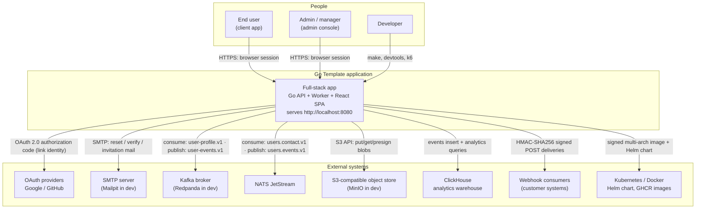

# 02 — System Context (C4 Level 1)

**In one sentence:** one product — *the Go Template application* — serves
browser users and programmatic clients through a single HTTP entry point,
and integrates with six kinds of external systems: identity providers,
email, event brokers, object storage, an analytics warehouse, and the
Kubernetes/compose platform that runs it.

The C4 **System Context** diagram is the highest-level view: people and
systems that interact with our software, nothing about internals.

## 2.1 Actors

| Actor | Interacts via | Typical intent |
|---|---|---|
| **End user** (requester / approver) | SPA at `/` (cookie session) | File tickets, approve requests, read notifications, manage own profile, MFA, API keys |
| **Admin / manager** | SPA at `/admin/*` (cookie session) | Manage users, roles, orgs, settings/flags, webhooks, streams, audit; approve first chain steps |
| **API / mobile client** | `Authorization: Bearer` (JWT grant or `gtpl_` API key) | Integrate ticket and user data programmatically |
| **Ops engineer** | `/metrics`, `/health/*`, `/version`, Grafana/Prometheus/Jaeger | Monitor, deploy, toggle maintenance mode |
| **Webhook consumer** | Receives signed HTTP POSTs | React to product events (e.g. ticket approved) |
| **Developer** | `make *`, compose profiles, `cmd/devtools`, Scalar `/docs` | Run, test, demonstrate |

## 2.2 Context diagram

## 2.3 Trust boundaries

1. **Browser ↔ API** — the only untrusted input surface. Protected by
   session cookies (`SameSite=Lax`, `HttpOnly`, `Secure`), an Origin/`Sec-Fetch-Site`
   CSRF check on non-GET API calls, body size caps, per-IP and per-identity
   rate limits, and security headers.
2. **API ↔ external systems** — every outbound call is breaker-wrapped and
   time-boxed (`APP_EXTERNAL_TIMEOUT`, default 3 s); webhook payloads are
   HMAC-signed so *consumers* can trust *us*.
3. **Broker ↔ worker** — consumers authenticate to the broker; messages are
   validated and malformed payloads are parked in a dead-letter queue
   rather than crash-looping the consumer.

## 2.4 What the system does *not* talk to

- No third-party analytics/tracking services; events go to the
  self-hosted ClickHouse.
- No external secrets manager — secrets come from the environment or
  mounted files (`*_FILE` convention), supplied by the platform
  (Kubernetes secrets, compose env).
- No CDN — the SPA ships inside the binary; assets are same-origin.

Next: [03 — Containers & Runtime Views](03-containers-and-runtime-views.md)
— what actually runs, process by process.
