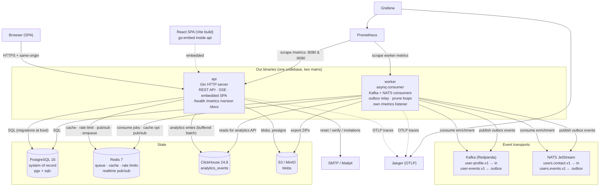

# 03 — Containers & Runtime Views (C4 Level 2)

**In one sentence:** two Go processes — the **api** (HTTP + embedded SPA +
SSE) and the **worker** (queues, stream consumers, outbox relay, retention
prunes) — share one codebase and one set of ports/adapters, and can run
against anything from *zero* infrastructure to the full PostgreSQL + Redis +
ClickHouse + Kafka + NATS + S3 + SMTP stack.

## 3.1 Container diagram



Notes on the arrows that surprise people:

- **The worker has its own `/metrics` listener** (`APP_METRICS_ADDR`,
  e.g. `:9090`) because stream/outbox/DLQ gauges live in the worker
  process, while the compose image `HEALTHCHECK` probes the *api* binary —
  so the worker service disables the inherited healthcheck.
- **Realtime across processes**: the api publishes domain events to a Redis
  pub/sub channel `app:realtime`; every api replica's SSE hub subscribes,
  so an event created by the worker (e.g. `job.updated`) reaches browsers
  connected to *any* api replica. Without Redis, SSE works but only inside
  the single process.
- **Analytics reads and writes both degrade**: without ClickHouse the api
  answers analytics endpoints from in-memory counters/trail; the
  in-memory *and* Postgres stores implement the same `EventSink` port.

## 3.2 Protocol & port matrix

| Component | Endpoint / port | Protocol | Who connects |
|---|---|---|---|
| api | `:8080` (all `/api/*`, SPA, `/health/*`, `/metrics`, `/version`, `/docs`, `/openapi.yaml`) | HTTP/1.1 | Browsers, k6, scripts |
| worker metrics | `APP_METRICS_ADDR` (compose `:9090`, Helm `:9091`) | HTTP | Prometheus |
| PostgreSQL | `5432` (host map `55432`) | PostgreSQL wire | api, worker, seeders |
| Redis | `6379` | RESP | api, worker |
| ClickHouse | `9000` native (host map), `8123` HTTP | Native | api (writes, buffered), analytics reads |
| Kafka (Redpanda) | `9092` internal, `19092` host | Kafka | worker consumers/relay, devtools, e2e |
| NATS | `4222`, monitoring `8222` | NATS | worker, devtools, e2e |
| MinIO | `19000` S3 API, `19001` console | S3 | api, worker |
| Mailpit | `1025` SMTP, `8025` Web UI | SMTP | api |
| Jaeger | `4318` OTLP/HTTP, `16686` UI | OTLP | api, worker |
| Prometheus → | `:9090` UI, scrapes both binaries | HTTP | Grafana |

## 3.3 The degradation ladder (the same binaries, four runtimes)

This is the template's signature property. The **same** `api` binary walks
down this ladder purely by environment variables:

| Mode | Command | Uses | Good for |
|---|---|---|---|
| **Zero-dependency** | `go run ./cmd/api` | In-memory store, in-process ticker queue (2 s poll), memory cache/limits, log mailer, no streams | Reading the code, tests, demos |
| **Hybrid dev** | `docker compose up -d postgres redis` + `go run ./cmd/api` | Real PG + Redis; hot-reload of Go code | Everyday feature work (`docs/quickstart.md`) |
| **Full compose** | `make docker-up` (+ `--profile observability`, `--profile mail`, `--profile files`, brokers overlay `make demo-up`) | Everything, including demo dataset | Integration checks, regression walkthrough |
| **Kubernetes** | Helm chart (`deploy/helm/go-template`) | Platform-provided PG/Redis/CH; HPA 2–10 api replicas, PDB, probes, secret mounts | Production shape |

Every rung is exercised by tests or the regression script — degradation is
a designed feature, verified behavior, not a happy accident
(ADR [0004](decisions/0004-graceful-degradation.md)).

## 3.4 Startup and shutdown (api binary)

```mermaid
sequenceDiagram
    autonumber
    participant M as main.go
    participant C as Config/Logger
    participant B as Bootstrap
    participant S as service.Container
    participant H as http.Server

    M->>C: config.Load — parse env, validate, fail-fast
    M->>M: signal.NotifyContext — SIGINT/SIGTERM
    M->>M: observ.SetupTracing — OTLP or no-op
    M->>B: bootstrap.Store — Postgres + migrations, or memory; ClickHouse open (warn-only)
    M->>B: realtime hub + Redis bridge (if Redis)
    M->>B: queue (asynq), cache (Redis or memory), file store (S3 or memory)
    M->>B: breakers registry + metrics hook
    M->>B: Casbin enforcer over RuleStore — fatal on error
    M->>B: mailer — SMTP if APP_SMTP_HOST, else log mailer
    M->>S: service.NewContainer — wire all services in dependency order
    M->>S: EnsureSystemRoles, realtime notifiers, webhook fan-out, demo seed
    M->>H: NewRouter with full middleware chain; ListenAndServe
    Note over H: "api listening" — addr, log level, store kind
    H-->>M: ctx.Done on signal
    M->>H: Shutdown(ShutdownTimeout, 10s)
    Note over H: open SSE streams can hold it → force Close with warning
    M->>M: deferred: tracing, store, bridge, queue closers
```

The **worker** startup mirrors this minus HTTP routing, and adds:
`bootstrap.Brokers` (Kafka + NATS clients with auto-created topology),
consumer goroutines under `supervise()` (restart with exponential backoff
2 s → 30 s), the outbox relay loop (1 s tick, 100-event batches, 60 s
leases), three prune loops (idempotency keys and MFA challenges every
10 min, refresh tokens hourly), the cron scheduler (`APP_REPORT_CRON`), and
the metrics listener.

## 3.5 Process responsibilities — the one-line rule

> The **api** owns everything synchronous a human triggers; the **worker**
> owns everything asynchronous or streaming.

| Concern | api | worker |
|---|---|---|
| HTTP API, SPA, SSE, auth, RBAC | ✔ | — |
| Enqueue jobs | ✔ | runs them ✔ |
| Webhook deliveries | enqueue ✔ | deliver ✔ (inline mode: api, dev only) |
| GDPR export | enqueue + download ✔ | build ZIP ✔ |
| Enrichment consumption | — | ✔ |
| Outbox relay | — | ✔ |
| Retention prunes | — | ✔ (export prune exposed, not yet scheduled — see [09](09-flows-business-domains.md) §4) |
| Migrations | at boot ✔ | — (shares the same store; runs are idempotent) |
| Metrics | via app port | via dedicated `APP_METRICS_ADDR` |

Next: [04 — Components & Code Map](04-components-and-code-map.md) — inside
the binaries.
