# 04 — Components & Code Map (C4 Level 3)

**In one sentence:** inside each binary the code is arranged as strict
concentric layers — HTTP handlers → services (business logic) → ports
(interfaces) → adapters (Postgres/memory/S3/SMTP/Kafka/NATS) — with
cross-cutting middleware doing auth, rate limiting, tracing and
idempotency *before* any handler runs.

## 4.1 Directory map (annotated, post-refactor layout)

> Updated 2026-10-01: the codebase was reorganized from package-by-layer to
> **package-by-feature** (ADR [0021](decisions/0021-package-by-feature.md),
> the [assessment](history/16-current-architecture-assessment.md) and
> [roadmap](history/18-migration-roadmap.md) record the before/after). Each feature
> now owns one package: its types, business logic, HTTP handlers, and its
> store interface.

```
├── cmd/
│   ├── api/            HTTP binary: config → bootstrap → router → serve
│   ├── worker/         Queue/stream binary: consumers, relay, prune loops, metrics
│   ├── seed/           Bulk performance seeder (100k users via pgx COPY)
│   ├── seed-demo/      Demo dataset loader (-reset to wipe first)
│   └── devtools/       Local toolbox: publish/consume events, DLQ, breaker, hammer demos
├── internal/
│   ├── api/            oapi-codegen GENERATED wire types only — do not edit
│   ├── <feature>/      19 FEATURE PACKAGES (auth, users, rbac, tickets, streams, jobs,
│   │                   files, export, webhooks, mfa, tokens, apikeys, email, invitations,
│   │                   notifications, analytics, audit, settings, search): each owns
│   │                   types + service + store.go (interface) + http.go (RegisterHTTP)
│   ├── kernel/         Shared vocabulary: sentinel errors, NewID, ListOptions,
│   │                   idempotency record/repo, Pinger — imports nothing internal
│   ├── cache/          Cache port + read-through helpers (adapters in platform/cache)
│   ├── httpx/          Cross-cutting HTTP helpers: problem+json, error mapping, binding,
│   │                   list parsing, session cookies — never imports a feature
│   ├── httpapp/        ASSEMBLY ONLY: middleware chain, auth dispatch (API key/JWT/
│   │                   session), org-domain + permission guards, SSE snapshot, SPA,
│   │                   health/version/docs/metrics, route registration
│   ├── bootstrap/      Wiring: store (pg/memory), file store, brokers, demo data,
│   │                   container.go (the composition root for both binaries)
│   ├── platform/       ADAPTERS: postgres (sqlc), queue (asynq), cache, ratelimit,
│   │                   filestore (S3/memory), mailer (SMTP/log), oauth, rbac (Casbin),
│   │                   kafka, nats, clickhouse — implement the feature Store interfaces
│   ├── repository/     In-memory store (implements every feature Store; one file per
│   │                   feature) — kept equivalent by contract tests
│   ├── realtime/       SSE hub, event types, Redis bridge, webhook fan-out sink
│   ├── reliability/    Circuit breaker, retry with jitter, bounded concurrency
│   ├── observ/         Prometheus metrics, OTel tracing setup, metric observers
│   ├── config/         Env parsing + validation; *_FILE secret convention
│   └── jobs/           (merged into the jobs feature package: task contract)
├── web/                React SPA (Vite); embed.go does //go:embed dist
├── migrations/         postgres/ (18 migrations), clickhouse/ (events)
├── queries/            23 sqlc query files, 190 named queries
├── api/openapi/        openapi.yaml (contract) + oapi-codegen config
├── deploy/             Helm chart, prometheus.yml, grafana provisioning
├── test/               integration/ (testcontainers), e2e/, performance/ (k6)
├── scripts/            regression-walkthrough.sh, demo-idempotency.sh
└── docs/               feature guides + this architecture set
```

The dependency rules that make it work:

```
httpapp → feature packages → kernel/cache/httpx ← platform, repository
feature → feature           (exported API only; cycles forbidden)
platform, repository → feature packages (to implement their Store interfaces)
```

Business logic never imports Gin, pgx, Kafka or any adapter package.
Compile-time assertions (`var _ tickets.Store = (*repository.MemoryStore)(nil)`)
pin both store adapters to every feature interface, and the contract tests
run identical behavioral suites against both.

## 4.2 Component diagram

```mermaid
flowchart TB
    subgraph httpapp["internal/httpapp — HTTP layer"]
        MW["middleware chain<br/>security · request id · tracing · metrics<br/>access log · maintenance · body cap<br/>rate limits · origin check · auth · idempotency"]
        H["handlers per domain<br/>(auth, users, tickets, files, ...)"]
        SSE["sse.go — live stream"]
        SPAH["spa.go — embedded SPA + fallback"]
        ERR["errors.go — problem+json mapping"]
    end

    subgraph service["internal/service — business logic"]
        AUTH["Auth"]
        MFA["MFA"]
        TOK["Tokens — JWT grants"]
        KEYS["APIKeys"]
        RBACS["RBAC (Casbin)"]
        USERS["Users (+cache)"]
        TCK["Tickets — state machine"]
        INV["Invitations"]
        FILES["Files"]
        EXP["Exports"]
        WH["Webhooks"]
        JOBS["Jobs"]
        STREAMS["Streams — enrichment"]
        MAIL["Email"]
        NOTIF["Notifications"]
        SET["Settings"]
        SEARCH["Search"]
        AUD["Audit"]
        RPT["Reports / Analytics"]
    end

    PORTS["ports.go — 25 repository/service interfaces"]

    subgraph adapters["adapters"]
        PG["platform/postgres<br/>pgx + sqlc (generated db package)"]
        MEM["repository — in-memory twin"]
        Q["platform/queue — asynq"]
        CACHE["platform/cache — memory/Redis"]
        RL["platform/ratelimit — memory/Redis"]
        FS["platform/filestore — S3/memory"]
        MAILER["platform/mailer — SMTP/log"]
        KFK["platform/kafka — franz-go"]
        NTS["platform/nats — JetStream"]
        CHK["platform/clickhouse"]
        CASB["platform/rbac — SyncedEnforcer"]
        OAUTH["platform/oauth"]
    end

    H --> AUTH & TCK & FILES & WH & JOBS & STREAMS
    MW --> RL & CACHE
    AUTH --> MFA & TOK & MAIL & AUD
    TCK --> NOTIF & AUD
    JOBS --> EXP & WH
    service --> PORTS
    PORTS -.implemented by.-> PG & MEM & Q & CACHE & RL & FS & MAILER & KFK & NTS & CHK & CASB & OAUTH
```



`service/container.go` builds all services in dependency order and injects
the optional collaborators (cache, notifier callbacks, breakers, queue,
mailer) — the single place where the object graph is defined for *both*
binaries.

## 4.3 The request lifecycle — full middleware chain

Every request passes, in order:

| # | Middleware (file) | Does |
|---|---|---|
| 1 | `gin.Recovery()` | Convert panics to 500 |
| 2 | `securityHeaders` (`security.go`) | `X-Content-Type-Options`, `X-Frame-Options: DENY`, `Referrer-Policy`, CSP; HSTS when `APP_COOKIE_SECURE=1` |
| 3 | `requestID` | Honor inbound `X-Request-ID` else generate; echo back; put in context |
| 4 | `tracing` (`observability.go`) | W3C tracecontext extract → server span `HTTP <method>`, renamed to route pattern after |
| 5 | `metrics` | In-flight gauge; `app_http_requests_total`, `app_http_request_duration_seconds` |
| 6 | `accessLog` | One slog line per request (`slow request` > 1 s) with method/path/status/duration/request id/user |
| 7 | `maintenanceGate` (`maintenance.go`) | When `maintenance.enabled`: 503 + `Retry-After: 30` for `/api/*` except login/logout/settings; memoized 5 s |
| 8 | `bodyLimit` | 1 MiB default cap (`413`); `/api/files` route raised to upload max + 1 MiB |
| — | *`/api` group:* `originCheck` | Reject non-GET whose `Sec-Fetch-Site`/`Origin` is cross-site (CSRF defense) |
| — | *`/api` group:* `apiRateLimit` | Per-IP token budget (scope `"api"`) → 429 + `Retry-After` |
| — | *authorized group:* `apiAuthRequired` | Resolve principal: `gtpl_…` API key → JWT (`…two dots`) → session cookie `app_session` / Bearer |
| — | *authorized group:* `identityRateLimit` | Per-user/API-key budget (scope `"user"`) |
| — | *authorized group:* `orgDomain` | `X-Org-Id` header → active Casbin domain in context |
| — | *per route:* `authRateLimit` | Tighter per-IP budget on credential endpoints |
| — | *per route:* `requirePermission(obj, act)` | Casbin check → 403 problem+json |
| — | *per route:* `etag` | Strong ETag on heavy GET lists; `If-None-Match` → 304 |
| — | *per route:* `idempotency` | `Idempotency-Key` replay store (currently `POST /api/tickets`) |
| — | handler | Bind → service call → JSON or problem+json |

## 4.4 Route map (condensed but complete)

Public (no auth): `POST /api/auth/register|login|logout`, `POST /api/auth/mfa/challenge`,
`POST /api/auth/token` + `/revoke` (JWT grants), `POST /api/auth/forgot-password|reset-password|verify-email`,
`GET /api/settings/public`, `GET /api/oauth/providers`, `GET /auth/:provider/login|callback` (OAuth link).

Authenticated self-service: `/me`, `/me/identities`, `/sessions`,
`/auth/mfa/*` (status/enroll/verify/disable), `/profile/logout-all`,
`/profile/unlink/:provider`, `/search`, `/notifications` (+ read/read-all/unread-count),
`/api-keys` CRUD, `/invitations` (+accept), `/impersonation/stop`,
`/events/stream` (SSE), `/users/me/export` (+status/download),
`/files` CRUD + `/content` + `/url`.

Permission-guarded (guard shown): `users:*` (`users:*`), `jobs` (`jobs:read/execute`),
`enrichment-profiles` (`enrichments:read`), `reports` (`reports:read/create`),
`analytics/*` (`analytics:read`), `audit` (`audit:read`), `settings` (`settings:read/update`),
`webhooks` (`webhooks:read/create/update/delete/execute`), `streams/outbox` + `dead-letters`
(`streams:read`, replay `streams:replay`), `impersonation` (`impersonation:execute`),
`tickets` + `approvals` + `ticket-types` (`tickets:read/read_all/create/update/delete/approve`,
`ticket_types:*`), `roles` + `policies` + `users/:id/roles` (`roles:*`, `policies:*`, `users:update`),
`orgs` + members + invitations (`orgs:read/update`), `rbac/catalog` (any authed user).

Infrastructure: `/health/live|ready|startup`, `/metrics`, `/version`,
`/docs` (Scalar UI over `/openapi.yaml`), optional `/debug/pprof/*`
(`APP_PPROF=1`), SPA fallback via `NoRoute`.

## 4.5 API conventions (the ones every handler obeys)

- **Errors are RFC 9457 problem+json**: `{"type":"about:blank","title","status","detail"}`.
  Domain errors map deterministically:

  | Error | HTTP | Title |
  |---|---|---|
  | `repository.ErrNotFound` | 404 | not found |
  | `repository.ErrConflict` | 409 | conflict |
  | `service.ErrInvalidTransition` | 409 | invalid transition |
  | `service.ErrAlreadyReplayed` | 409 | already replayed |
  | `reliability.ErrCircuitOpen` | 503 | dependency temporarily unavailable |
  | `service.ErrInvalidCredentials` | 401 | invalid credentials |
  | `service.ErrForbidden` / Casbin denial | 403 | forbidden |
  | validation error | 400 | validation failed |
  | body too large (`MaxBytesError`) | 413 | — |
  | anything else | 500 (detail suppressed, logged) | internal error |

- **Lists** return `{"data": [...], "next_cursor": "..."}` (empty string on
  the last page; nil slices are coerced to `[]`); single objects return bare.
- **Pagination** is a first-class dimension: `mode=offset|cursor|keyset`
  with `limit` (default 25) and `after` — the SQL for all three is written
  per query file in `queries/` and contract-tested to agree.
- **SSE wire format** (`GET /api/events/stream`): `data: {"type": <name>, "payload": {...}}`;
  types `connected`, `snapshot` (summary + last 10 jobs, every 5 s),
  `analytics.event`, `job.updated`, `ticket.updated`, `notification.created`;
  heartbeat comment `: ping` every 15 s; `X-Accel-Buffering: no` for proxies.
- **IDs** are 16 random bytes, base64url — no sequential integer leaks.
- **Auth specials**: `401 {"mfa_required": true, "challenge": ...}` and
  `403 {"mfa_enrollment_required": true}` carry the MFA protocol;
  token grants return `{"access_token","token_type","expires_in","refresh_token"}`.

## 4.6 Frontend component map (same C4 level, SPA side)

```
web/src/
├── main.tsx                 providers: QueryClient, ThemeProvider (6 themes), Toaster
├── routes/                  TanStack Router file-based routing (routeTree.gen.ts)
│   ├── __root.tsx           root + custom 404
│   ├── login|register|forgot-password|reset-password|verify-email|accept-invitation
│   ├── _client.tsx          pathless layout: ensureAuth guard → ClientShell
│   ├── _client.*.tsx        /  /tickets /tickets/$ticketId /approvals /notifications /profile
│   ├── admin.tsx            layout: ensurePermission(admin_console, access) → AppShell
│   └── admin.*.tsx          16 console pages (users, jobs, streams, roles, policies, orgs,
│                            audit, settings, webhooks, analytics, reports, ticket-types, ...)
├── components/              shells (app-shell, client-shell), header widgets, banners, tables
│   ├── ui/                  30 vendored shadcn/ui components (Radix under the hood)
│   └── data-table/          table + pagination-bar + mode/view switchers
├── hooks/                   use-event-stream (SSE), use-paged-list, use-permissions, use-mobile
└── lib/                     api.ts (fetch wrapper), auth.ts (guards + me query), router.ts,
                             types.ts, search.ts (URL search schemas), i18n.tsx (EN/RU), utils.ts
```

Frontend conventions: all table state lives in the URL (`mode`, `view`,
`page`, `after`, `q`, `status`, `type` via zod `validateSearch`); server
state is TanStack Query with prefix-key invalidation (`["tickets", ...]`);
permissions come from `/me` (`EffectivePermissions`, wildcard-expanded by
the backend) and are checked with `useCan(obj, act)`; exactly one
`EventSource` per shell shared through `LiveProvider`; **no global state
library** — local component state + URL + two localStorage keys
(`app.activeOrg`, `app.locale`).

Next: [05 — Technology Stack](05-technology-stack.md).
