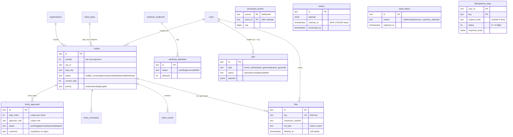

# 06 — Data Model

**In one sentence:** PostgreSQL is the single system of record (30+ tables,
18 forward-only migrations, all access through reviewed sqlc queries);
ClickHouse holds the event firehose; Redis holds
only *reconstructible* state (queue, cache, rate windows, pub/sub); S3
holds blobs; and every secret token in Postgres is stored as a hash.

## 6.1 Storage engines and what belongs where

| Store | Contains | Never contains |
|---|---|---|
| **PostgreSQL** | Users, credentials, sessions, tokens, RBAC, orgs, tickets, audit, settings, notifications, webhooks, files metadata, jobs, streams bookkeeping (inbox/outbox/DLQ/idempotency) | Anything reconstructible or ephemeral |
| **ClickHouse** | `analytics_events` — append-only product events | Anything that must be transactional with domain writes |
| **Redis** | asynq tasks, cache entries (`user:*`, `perms:*`, TTL 30 s), rate-limit windows, `app:realtime` pub/sub | Source of truth — Redis can be flushed with zero data loss |
| **S3/MinIO** | Blob bytes, keyed `{id}/{sanitized-filename}`; `exports/{userID}/{id}.zip` | Metadata (that lives in `files` table) |
| **In-memory (dev)** | The whole Postgres surface in `repository.MemoryStore` — same contract, tested side-by-side | — |

## 6.2 ER diagram — identity, tenancy & access

```mermaid
erDiagram
    users ||--o{ auth_identities : "OAuth links"
    users ||--o| password_credentials : "password"
    users ||--o{ sessions : "browser sessions"
    users ||--o{ refresh_tokens : "JWT families"
    users ||--o| mfa_factors : "TOTP secret"
    users ||--o{ mfa_recovery_codes : "10 single-use"
    users ||--o{ mfa_challenges : "5-min TTL"
    users ||--o{ email_tokens : "reset / verify"
    users ||--o{ api_keys : "gtpl_ keys"
    users ||--o{ notifications : "inbox"
    users ||--o{ org_members : "membership"
    organizations ||--o{ org_members : "has"
    organizations ||--o{ org_invitations : "invites"
    organizations ||--o{ ticket_types : "or platform-wide"
    roles ||--o{ casbin_rule : "g rules use"
    users ||--o{ casbin_rule : "g(p) rules"

    users {
        text id PK
        text email UK
        text name
        text external_ref UK "partial unique - broker identity"
        jsonb enrich_profile "kafka-owned fields"
        jsonb enrich_contact "nats-owned fields"
        bigint enrich_profile_seq
        bigint enrich_contact_seq
        tsvector search_vec "generated, GIN"
    }
    sessions {
        text token PK "opaque 16B base64url"
        text user_id FK
        timestamptz expires_at "sliding"
        text impersonated_by
    }
    refresh_tokens {
        text id PK
        text family_id "reuse-detection group"
        text token_hash UK "sha256"
        timestamptz revoked_at
    }
    api_keys {
        text id PK
        text prefix "gtpl_+6 chars"
        text key_hash UK
        text_array scopes "obj:act"
        timestamptz expires_at
        timestamptz revoked_at
    }
    organizations {
        text id PK
        text slug UK
    }
    org_invitations {
        text id PK
        text token_hash UK
        text status "pending|accepted|revoked|expired"
        timestamptz expires_at "7 days"
    }
```

Key decisions visible in the shape:

- **Case-insensitive email** via `UNIQUE INDEX users(lower(email))` — no
  `citext` extension, no `pgcrypto`; the app owns all crypto.
- **`external_ref`** (partial unique) is the join key between local users
  and broker events — enrichment never matches on email.
- **`enrich_profile` / `enrich_contact` + their `seq` bigints** implement
  field ownership and stale-event rejection (see [10 — Event Streams](10-flows-event-streams.md)).
- **`sessions.impersonated_by`** makes impersonation a property of the
  session, not a role change — the admin never "becomes" the user in the
  permission system.

## 6.3 ER diagram — business & operations

## 6.4 The rest of the relational surface

| Table (migration) | Purpose | Notable columns / mechanics |
|---|---|---|
| `audit_log` (000005) | Immutable who/what/when | `diff jsonb {"before","after"}`, `ip`, `request_id`, `domain`; only retention deletes rows |
| `settings` (000006) | Typed KV flags | `value jsonb` (JSON literals); closed catalog enforced in code |
| `notifications` (000007) | In-app inbox | Partial index `WHERE read_at IS NULL` for the badge |
| `email_tokens` (000008) | Reset/verify tokens | `kind CHECK (reset,verify)`, `token_hash UNIQUE`, `used_at` — single-use by update |
| `oauth_states` (000002) | CSRF state for OAuth link | consume = delete-first |
| `user_enrichment_profiles` (000001/3) | Fetched third-party profiles | `seq bigserial` for keyset listing |
| `reports` (000001) | Report snapshots | cron-scheduled generation optional |
| `mfa_*` (000014) | TOTP factors, recovery codes, challenges | all secrets hashed; challenges pruned every 10 min |
| `roles`, `casbin_rule` (000004) | Role catalog + persisted Casbin policies | `ptype, v0..v5`; index `(ptype,v0,v1)` |
| `analytics_events` (ClickHouse) | Event warehouse | `MergeTree ORDER BY (event_name, occurred_at)`, `LowCardinality(String)` event names, `properties` JSON string |

## 6.5 How data access is written (the sqlc discipline)

1. **Migrations** in `migrations/postgres/NNNNNN_name.{up,down}.sql` —
   plain SQL, no extension dependencies, applied at boot by golang-migrate
   (embedded FS).
2. **Queries** in `queries/<domain>.sql` — 23 files, 190 named queries,
   each annotated with `:one` / `:many` / `:exec` / `:execrows`.
3. **Codegen** — `make generate` runs sqlc (`out: internal/platform/postgres/db`)
   and oapi-codegen; generated files are committed but never edited.
4. **Type mapping** — `timestamptz → time.Time`, `jsonb → string`
   (marshalling stays in the service layer).

Performance-relevant SQL patterns worth copying:

- **Keyset pagination**: composite index `(created_at DESC, id ASC)` and
  `WHERE (created_at, id) < ($after_ts, $after_id)` — offset, cursor and
  keyset modes exist side-by-side and are contract-tested to agree.
- **Per-org sequences**: `MAX(number)+1 WHERE org_id = $org` inside the
  insert transaction, enforced by `UNIQUE (org_id, number)`.
- **Soft delete** for files (`deleted_at` + partial index
  `WHERE deleted_at IS NULL`).
- **Lease-based outbox claim**: `FOR UPDATE SKIP LOCKED` +
  `claimed_at` lease so multiple relay workers are safe.
- **Sliding session expiry**: refreshed in the same `UPDATE ... RETURNING`
  statement that reads the session.
- **Search**: generated `tsvector` STORED columns with GIN indexes, config
  `'simple'` (no stemming — mixed EN/RU), queried with
  `websearch_to_tsquery`, ranked by `ts_rank` then recency. Zero
  extensions required.

## 6.6 Retention & lifecycle

| Data | Lifetime | Mechanism |
|---|---|---|
| Sessions | `APP_SESSION_TTL` (7 d), sliding | expiry checked + refreshed on read |
| Refresh tokens | `APP_JWT_REFRESH_TTL` (30 d) | hourly prune loop |
| MFA challenges | 5 min | prune loop every 10 min |
| Idempotency records | `APP_IDEMPOTENCY_TTL` (24 h) | prune loop every 10 min |
| Email tokens | reset 1 h / verify 24 h | checked at consume |
| Invitation tokens | 7 d | expiry flip + check at accept |
| Export ZIPs | 7 d | `ExportService.Prune` (exposed for a scheduler; not yet wired into the worker loop) |
| Audit | `audit.retention_days` (365) | `DeleteAuditOlderThan`, callable |
| Outbox (processed) | 7 d | `DeleteOldOutbox` |
| Analytics events | indefinitely | ClickHouse TTL is intentionally not set — add per your policy |

Next: [07 — Flows: Authentication & Identity](07-flows-authentication-and-identity.md).
