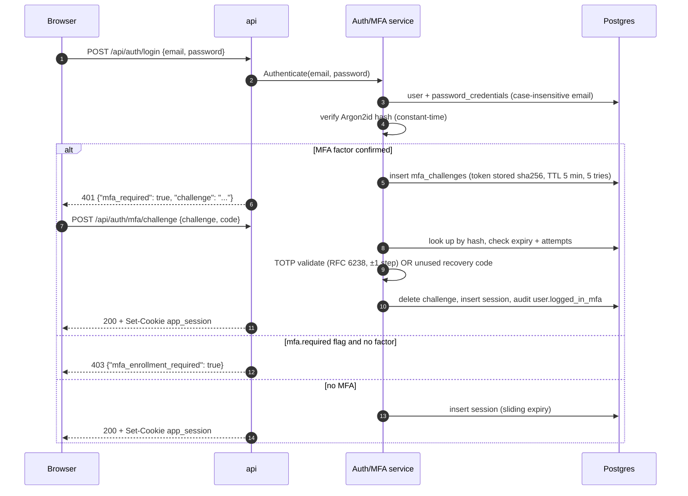

# 07 — Flows: Authentication & Identity

**In one sentence:** browsers authenticate with opaque server-side sessions
(Argon2id passwords, optional TOTP step), while machines authenticate with
JWT grants (rotation + reuse detection) or scoped `gtpl_` API keys — and
every secret that touches storage is a hash.

## 7.1 The authentication decision matrix

| Principal type | Transport | Server-side state | TTL | Revocation |
|---|---|---|---|---|
| **Session** | `app_session` cookie (`HttpOnly`, `SameSite=Lax`, `Secure` per config) or the same token as `Bearer` | Row in `sessions` (opaque token PK), **sliding expiry** | `APP_SESSION_TTL`, 7 d | delete row; "log out everywhere" deletes all |
| **JWT access token** | `Authorization: Bearer ey…` (two dots) | **None** — stateless verification | `APP_JWT_ACCESS_TTL`, 15 min | wait out the TTL; revoke the family's refresh to stop renewal |
| **JWT refresh token** | request body of the `refresh_token` grant | Row in `refresh_tokens` (sha256 hash, `family_id`) | 30 d | single revoke, or family revoke on reuse detection |
| **API key** | `Authorization: Bearer gtpl_…` | Row in `api_keys` (sha256 hash, prefix index) | optional `ttl` | soft revoke (`revoked_at`) |
| **OAuth identity** | linking flow (not a login) | row in `auth_identities` | — | unlink |

Why sessions for browsers and JWT for machines: sessions give instant,
server-side revocation and can carry impersonation metadata; JWT gives
stateless verification and short TTLs for API/mobile clients. Both paths
converge on the same RBAC checks. ADR
[0005](decisions/0005-sessions-vs-jwt.md).

## 7.2 Password hashing

Argon2id with parameters `time=1, memory=64 MiB, threads=4, keyLen=32`,
16-byte random salt, encoded `base64(salt) + ":" + base64(hash)`.
Verification is constant-time. The same function is exported for seeders
(`cmd/seed` computes one hash and shares it across 100k rows).

## 7.3 Login flow (with the MFA branch)



Facts worth knowing:

- The MFA **challenge token** and **recovery codes** are stored only as
  sha256 hashes; recovery codes are 10 × lowercase base32, shown once at
  enrollment, consumed single-use.
- Enrollment (`/auth/mfa/enroll` → `/auth/mfa/verify`) returns the
  `otpauth://` URL (rendered as a QR client-side) and then the recovery
  codes. Disable requires **password + current TOTP**. Admin reset
  (`DELETE /users/:id/mfa`, `users:update`) wipes the factor and notifies
  the user.
- Sessions **slide**: reading a valid session refreshes its expiry in the
  same SQL statement. Sessions are listed publicly only by 8-char prefix.
- The email uniqueness is case-insensitive; password reset emails never
  reveal whether an account exists.

## 7.4 JWT grants — password, mfa_challenge, refresh_token

`POST /api/auth/token` (needs `APP_JWT_SECRET` ≥ 32 bytes; otherwise 501).
Access tokens are HS256, claims `iss=go-template, sub, typ=access, iat,
exp, jti` — **identity only**, authorization stays server-side (Casbin).

```mermaid
sequenceDiagram
    autonumber
    participant C as API client
    participant A as api
    participant T as TokenService
    participant P as Postgres
    C->>A: POST /api/auth/token {grant_type: "password", email, password}
    A->>T: PasswordGrant
    T->>P: verify credentials (Argon2id)
    alt MFA enrolled
        A-->>C: 401 mfa_required + challenge
        Note over C: then grant_type "mfa_challenge" with the code
    end
    T->>P: insert refresh_tokens (family_id = new family)
    A-->>C: {access_token (15 m), refresh_token (30 d), expires_in}
    C->>A: POST /api/auth/token {grant_type: "refresh_token", refresh_token}
    T->>P: lookup by sha256 hash
    alt token already revoked — REUSE DETECTED
        T->>P: revoke the whole family
        A-->>C: 401 "refresh token reuse detected; the token family was revoked"
    else valid
        T->>P: revoke old token (replaced_by), issue sibling in same family
        A-->>C: new access + refresh
    end
```

The **family** is the security core: one login = one `family_id`; each
refresh rotates the token within the family; presenting an *already
rotated* (revoked) token is treated as theft and kills every token in the
family. `POST /api/auth/token/revoke` revokes one token; the family dies
with it. Expired refresh tokens are pruned hourly by the worker.

## 7.5 Password reset & email verification

Both flows share one mechanism — single-use hashed email tokens
(`email_tokens`, kind-checked, 32 random bytes, only sha256 stored):

- **Reset** (kind `reset`, TTL 1 h): `POST /auth/forgot-password` always
  answers success (no account enumeration); the email carries
  `{BaseURL}/reset-password?token=…`. `POST /auth/reset-password` consumes
  the token, sets the new Argon2id hash, **revokes all sessions**, and
  sends an in-app `security.password_changed` notification. In dev the raw
  link is logged at debug level when no mailer is configured.
- **Verify** (kind `verify`, TTL 24 h): same token table; consumption is
  the proof of verification.

## 7.6 OAuth (Google / GitHub) — link-only by design

The template links external identities to an existing account instead of
delegating login ("link-only" keeps the security surface and the RBAC
model simple — flip it to login by issuing a session after `LinkIdentity`
if you want):

```mermaid
sequenceDiagram
    autonumber
    participant B as Browser
    participant A as api
    participant G as Google/GitHub
    B->>A: GET /auth/google/login (must have a session)
    A->>A: save oauth_states {state, provider, user_id, TTL 10 m}
    A-->>B: 303 redirect to provider
    G-->>A: GET /auth/google/callback?code&state
    A->>A: ConsumeState — delete-first (single use), must match session user
    A->>G: exchange code → profile (subject, email, name, avatar)
    A->>A: LinkIdentity — unique (provider, subject); re-link idempotent;<br/>conflict if owned by another user
    A-->>B: 303 /profile
```

## 7.7 API keys — `gtpl_…`

- Format: `gtpl_` + 32 random bytes base64url. Only the sha256 hash is
  stored; the display prefix (`gtpl_` + 6 chars) is what listings show and
  what lookup uses.
- Shown **exactly once** at creation; scoped with `obj:act` strings
  narrowed from the permission catalog; optional `ttl`.
- Resolution: prefix lookup → expiry check → constant-time hash compare →
  `last_used_at` touch. The key resolves to its **owner**, so RBAC is the
  owner's; the scope list is stored on the key and exposed in context —
  note for adopters: scope *enforcement* beyond owner RBAC is a listed
  extension point in [15 — Template Guide](15-template-guide.md).
- Endpoints are self-service (`GET/POST /api/api-keys`,
  `DELETE /api/api-keys/:id`); audit `api_key.created|revoked`.

## 7.8 Impersonation — audited "sign in as"

```mermaid
sequenceDiagram
    autonumber
    participant Admin as Admin browser
    participant A as api
    participant Target as Target user
    Admin->>A: POST /api/impersonation {user_id} (impersonation:execute)
    A->>A: reject self-impersonation
    A->>A: create session for target with impersonated_by = admin
    A->>A: audit impersonation.started + notify target
    A-->>Admin: target session cookie; UI shows amber banner
    Admin->>A: POST /api/impersonation/stop
    A->>A: delete impersonating session, mint fresh admin session
    A->>A: audit impersonation.stopped
    Note over Target: /me reports impersonated + impersonator_name
```

The admin's permissions never change — they act *inside the target's
identity* with a visible banner and a full audit trail.

## 7.9 Identity completeness checklist

| Concern | Handled by |
|---|---|
| Password strength | ≥ 8 chars at registration and reset |
| Credential stuffing | per-IP `authRateLimit` (5 rps / burst 10) on all credential endpoints |
| Session fixation | new token on every login/challenge/impersonation-stop |
| Enumeration | uniform errors on login, reset, invitations |
| Replay of email/MFA/recovery/API-key/refresh tokens | sha256 + single-use/state columns |
| CSRF | `SameSite=Lax` + Origin/`Sec-Fetch-Site` middleware (see [11 — Security](11-security.md)) |
| Machine-client revocation | token revoke endpoint + family kill on reuse |

Next: [08 — Flows: Authorization & Tenancy](08-flows-authorization-and-tenancy.md).
