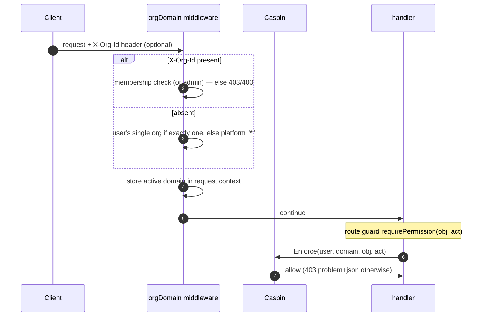

# 08 — Flows: Authorization & Tenancy

**In one sentence:** authorization is Casbin RBAC where **domains are
organizations** — a user holds roles per tenant, permissions are
`resource:action` pairs checked by middleware at every guarded route, and
an `X-Org-Id` header (or a UI switcher) selects the active tenant for the
whole request.

## 8.1 The model, in plain words

Casbin policy lines (stored in `casbin_rule`, enforced by a
`SyncedEnforcer`):

- `p, subject, domain, object, action` — a permission grant
- `g, user, role, domain` — "user has role in domain"

Matching rule, in English: *the caller holds the role in the active domain
**or** in the platform domain `*`, **and** the policy's domain covers the
active one, **and** object/action match with `keyMatch2` wildcards
(`tickets:*` matches `tickets:approve`).*

Two constants matter: domain **`*`** means *whole platform*; the nil
enforcer (worker without RBAC wiring) **denies everything** — safe by
default.

## 8.2 Built-in roles and their permission matrix

Seeded idempotently at boot (`EnsureSystemRoles`), all in domain `*`:

| Role | Grants (catalog `resource:action`) |
|---|---|
| `superadmin` | `*:*` — unrestricted |
| `admin` | full `users/roles/orgs/jobs/reports/tickets/ticket_types/webhooks/api_keys/streams/settings` + `enrichments:read`, `analytics:read`, `audit:read`, `impersonation:execute`, `admin_console:access` |
| `manager` | `users:read/update`, `jobs:read/execute`, `reports:read/create`, `enrichments:read`, `analytics:read`, `tickets:read/read_all/create/update/delete/approve`, `ticket_types:read`, `streams:read/replay`, `admin_console:access` |
| `requester` | `tickets:read/create/update/delete` |
| `approver` | `tickets:read`, `tickets:approve` |
| `viewer` | `jobs:read`, `reports:read`, `enrichments:read`, `analytics:read`, `tickets:read`, `admin_console:access` |

Registration grants: the **first account becomes `superadmin`**, every
later one `viewer` (in domain `*`).

The full catalog (`Resources`) covers 17 resources, including the three
special actions worth naming: `tickets:read_all` (org-wide list),
`tickets:approve` (decide a step), `admin_console:access` (the SPA's route
gate). Custom roles are editable in Admin → Roles (a resource × action
matrix per domain); admins can also edit raw `p`/`g` lines in Admin →
Policies.

## 8.3 Tenancy flow — how a request gets its domain



Where checks happen:

| Layer | Check |
|---|---|
| Middleware `requirePermission` | the primary gate on ~50 routes |
| Service layer | finer rules: `tickets:read_all` for `scope=all`, ticket `canView`/`canDecide`, search section scoping, org membership |
| Frontend | `ensurePermission("admin_console","access")` on `/admin/*` and `useCan()` for hiding buttons — **UX only**; every admin API re-checks server-side |
| Cache | expanded permission set cached as `perms:<domain>:<user>` (TTL 30 s), invalidated on any policy/role mutation |

## 8.4 Organization invitations

```mermaid
sequenceDiagram
    autonumber
    participant Adm as Org admin
    participant A as api
    participant M as Mailpit / SMTP
    participant Inv as Invitee
    Adm->>A: POST /orgs/:id/invitations {email, role} (orgs:update)
    A->>A: org exists, role exists, email not already a member,<br/>no duplicate pending — else uniform 409
    A->>A: create org_invitations (status pending, token sha256, TTL 7 d)
    A->>M: invitation email with {BaseURL}/accept-invitation?token=...
    A-->>Adm: 201 (token echoed for dev/test convenience)
    Inv->>Inv: signs in first (accept requires auth)
    Inv->>A: POST /invitations/accept {token}
    A->>A: resolve by hash — pending + unexpired, else 409
    A->>A: insert org_members (idempotent) + AssignRole(user, role, org)
    A->>A: status = accepted; audit invitation_accepted
    Note over Inv: refresh → sees the org in the scope switcher
```

Lifecycle: `pending → accepted | revoked (admin) | expired (batch flip)`.
Single-use by construction: the raw token exists only in the email; the DB
holds the hash.

## 8.5 Multi-tenancy data isolation rules

- Every tenant-scoped table carries `org_id` (tickets, ticket types, files,
  jobs attribution, webhook endpoints).
- The **active domain** is not client-trusted for data filtering: services
  re-derive membership, and the domain is what Casbin checks against.
- A user with roles in `[org, *]` gets the union; org-scoped managers (like
  demo user `demo-u-0010`, manager in Acme) see only their tenant's lists.
- Switching scope in the UI invalidates all queries and sends `X-Org-Id`
  on every subsequent request (localStorage `app.activeOrg`).

## 8.6 Authorization flows that pair with tickets

Approval decisions (the `approver` experience) combine role + permission +
state:

- inbox `GET /approvals` requires `tickets:approve` and returns tickets
  `in_review` whose **current pending step's `approver_role` is one of the
  caller's roles in the active domain**;
- deciding (`approve`/`reject`) re-checks `canDecide`: current step
  pending + role match (or org admin) + `tickets:approve`;
- `reject` **requires a comment**; later pending steps flip to `skipped`.

The full state machine, including requester-side `withdraw`/`complete`/
`reopen`, lives in [09 — Business Domains](09-flows-business-domains.md) §1.

## 8.7 Audit: the accountability layer for everything above

Every mutation described here writes an immutable `audit_log` row — actor,
active domain, resource, `{"before","after"}` diff, IP, request id — via a
helper that **never fails the request**. Actions include
`role.created|permissions_updated`, `policy.added|removed`,
`user.role_assigned|role_revoked`, `org.invited|invitation_accepted`,
`impersonation.started|stopped`, `settings.updated`, and the full
`ticket.*` vocabulary. Admin → Audit filters by actor/action/resource;
`GET /users/:id/activity` shows the per-user timeline (as actor or subject).

Next: [09 — Flows: Business Domains](09-flows-business-domains.md).
