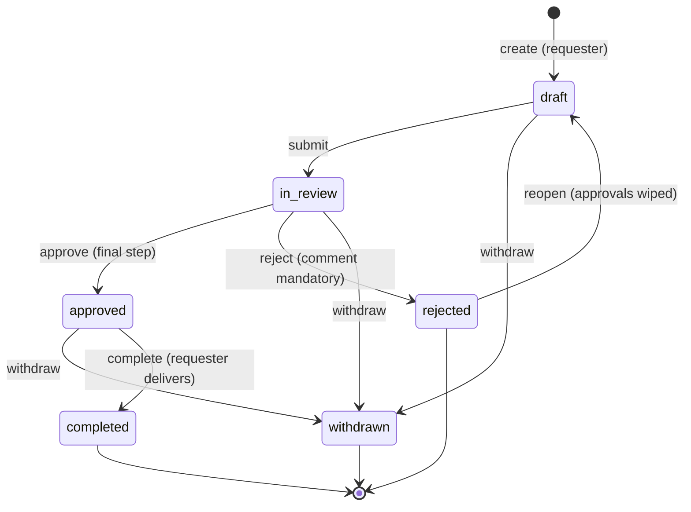
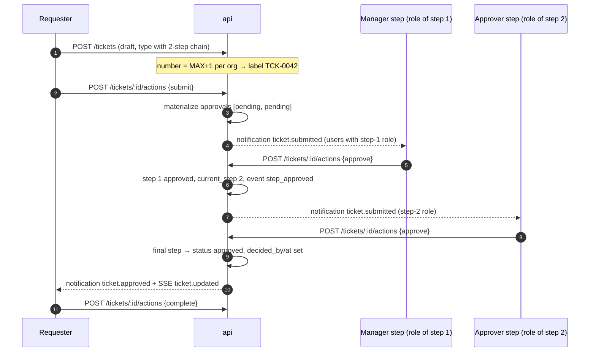
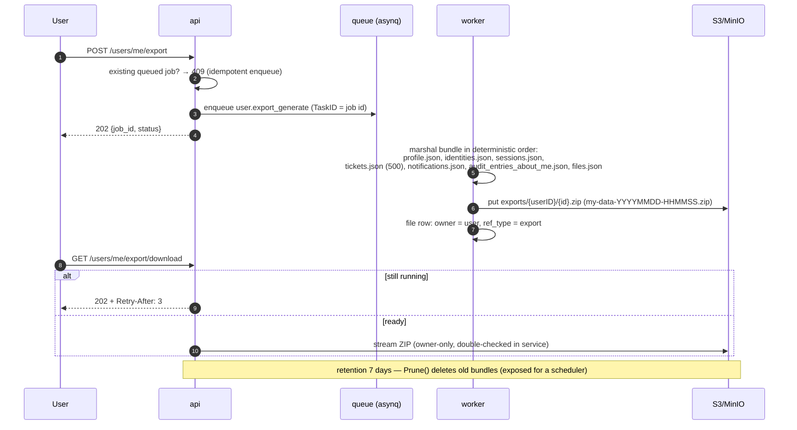
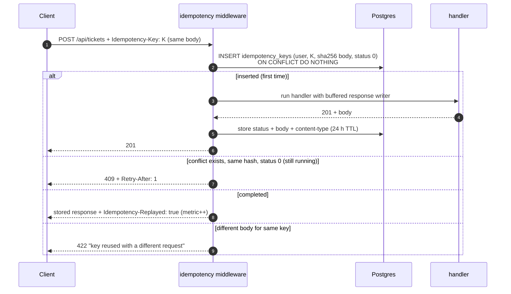
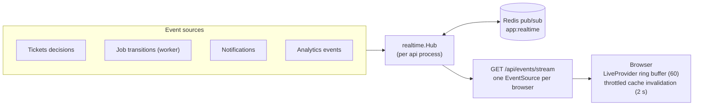

# 09 — Flows: Business Domains

**In one sentence:** the demo product is a ticket-desk with approval
chains, and around it the template exercises every horizontal capability a
real product needs — files, background jobs, webhooks, notifications with
live SSE, caching/ETags, idempotent writes, feature flags and audit — each
in its simplest production-grade form.

## 9.1 Tickets & approvals — the state machine



Rules enforced in `internal/service/tickets.go`:

| Action | From | Who | Extra |
|---|---|---|---|
| `submit` | `draft` | author | type must be `Active` with ≥ 1 step; materializes pending approval rows from the type's chain |
| `approve` | `in_review` | current step's role (or org admin) **and** `tickets:approve` | last step → `approved`; otherwise `current_step++`, event `step_approved`, next role notified |
| `reject` | `in_review` | same guard | **comment mandatory**; later pending steps → `skipped` |
| `withdraw` | `draft`, `in_review`, `approved` | author | pending steps → `skipped` |
| `complete` | `approved` | author | "requester delivers the result" |
| `reopen` | `rejected` | author | approvals wiped, back to `draft`, step 0 |

Illegal transitions → `409 invalid transition`. Visibility is checked
*before* transition validation, so outsiders get `404`/`403` rather than
state leakage. `rejected` vs `withdrawn` are deliberately distinct terminal
states — refused-by-approver is not the same as pulled-by-requester.

### The approval chain, end to end



Supporting surfaces: comments (anyone who can view), timeline events
(`created, submitted, step_approved, approved, rejected, withdrawn,
completed, reopened, commented, attachment_added`), per-status count chips
(`GET /tickets/counts`), the approvals inbox with a decided tab, org-wide
tabs behind `tickets:read_all`, and analytics events for every action.
Ticket **types** configure the chain: ordered steps of `{name,
approver_role}` stored as jsonb on `ticket_types`; `org_id = ''` means
platform-wide.

## 9.2 Files & attachments

```mermaid
sequenceDiagram
    autonumber
    participant C as Client
    participant A as api
    participant FS as filestore (S3/MinIO or memory)
    participant P as Postgres
    C->>A: POST /api/files (multipart: file, ref_type?, ref_id?)
    A->>A: size pre-check vs APP_FILES_MAX_MB (413)
    A->>A: stream through sha256 + 10 MiB cap (TeeReader)
    A->>FS: Put(key = id/sanitized-filename, bytes)
    A->>P: insert files row (checksum, ref) — on failure delete blob (no orphans)
    A-->>C: 201 metadata
    C->>A: GET /api/files/:id/content
    A->>A: canRead: ticket attachments follow ticket visibility; else owner-only
    A->>FS: Open + stream with Content-Disposition: attachment
    C->>A: GET /api/files/:id/url
    A->>FS: PresignGet 15 min (memory store → 501)
```

Rules: only `ref_type=ticket` linkage is supported (validated through the
full ticket `canView` rules — foreign tickets answer 404); delete is
owner-only and soft (`deleted_at`); there is **no virus scan and no
content-type allowlist** (named extension point). The SPA does not yet
surface attachments in the UI; the API and regression script cover the
flow end-to-end.

## 9.3 GDPR data export (portability)



Without Redis the job stays `queued` until `POST /api/jobs/process` runs it
in-process — deliberate dev-mode behavior.

## 9.4 Webhooks — signed, queued, retried

```mermaid
sequenceDiagram
    autonumber
    participant E as Domain event<br/>(any analytics event)
    participant F as WebhookSink fan-out
    participant Q as queue: webhook.deliver
    participant W as worker
    participant C as Consumer URL
    E->>F: {event, user_id, occurred_at}
    F->>F: endpoints matching event name (or "*") + active + webhooks.enabled
    F->>Q: enqueue delivery (TaskID = delivery id, MaxRetry 3, 30 s timeout)
    W->>C: POST raw payload<br/>X-Template-Signature: sha256=hex(HMAC-SHA256(body, secret))<br/>X-Template-Delivery: <delivery id>
    alt 2xx
        W->>W: delivery = success
    else transport error / non-2xx
        W->>W: delivery = failed (+attempts, last_error); asynq retries
    end
    Note over W,C: every POST runs inside breaker "webhooks.http" —<br/>a dead endpoint trips open and deliveries fail fast
```

Delivery records keep the full log (`GET /webhooks/:id/deliveries`);
secrets are auto-generated and shown once; `POST /webhooks/:id/test` sends
a `webhook.test` event. There is **no auto-disable after repeated
failures** — the breaker + delivery log are the current failure story
(auto-disable is a listed extension point). Consumers verify the HMAC with
the secret they saved at subscription time.

## 9.5 Background jobs — one contract, four task types

| Task type | Trigger | Timeout | Retries | What it does |
|---|---|---|---|---|
| `user.enrich_batch` | admin UI / API (`jobs:execute`), count 1–100 | 5 m | 5 | Fetches N profiles (randomuser.me) with bounded concurrency (8) + retry, behind breaker `enrichment.http`; 4xx = permanent |
| `user.report_generate` | API, or cron `APP_REPORT_CRON` | 1 m | 5 | Snapshot summary into a report row |
| `user.export_generate` | self-service export | 10 m | 5 | Builds the GDPR ZIP (§9.3) |
| `webhook.deliver` | webhook fan-out | 30 s | 3 | Delivers one signed POST (§9.4) |

Mechanics that matter: **asynq `TaskID` = job id** makes enqueue
idempotent (producer retries cannot duplicate work); the `jobs` table row
(`queued → running → done|failed`) is the audit/status surface; every
transition emits SSE `job.updated` (via Redis pub/sub across replicas) and
a `job.<status>` notification to the owner; metrics `app_jobs_*` track
queue/throughput/duration; payloads are versioned (`payload_version: 1`).

## 9.6 Idempotent writes — `Idempotency-Key`



Keys are namespaced `(user_id, key)`, capped at 200 chars, pruned every
10 minutes. The regression script proves the whole contract live: two
identical POSTs → two `201`s where the second **is** the stored replay,
one ticket created, `app_idempotency_replays_total` = 1.

## 9.7 Caching, ETags and search — the read-path toolkit

- **Read-through cache** for the two hottest, cheapest-to-invalidate
  objects: `user:<id>` and `perms:<domain>:<user>`, TTL 30 s, JSON
  payloads, `singleflight` against stampedes, invalidated on
  update/delete/policy-change. Memory adapter in dev; Redis adapter shared
  across replicas in prod. Sessions are never cached (they slide and
  revoke).
- **ETag/304** on heavy GET lists (`/users`, `/users/:id`, `/jobs`,
  `/tickets`, `/analytics/summary`): strong `sha256`-of-body tags computed
  on responses up to 2 MiB; `If-None-Match` matching (weak-prefix
  tolerant) returns an empty 304.
- **Search** `GET /api/search?q=`: permission-scoped — the users section
  needs `users:read`, tickets need `tickets:read` and collapse to the
  caller's own tickets without `tickets:read_all`. Postgres path is
  `tsvector @@ websearch_to_tsquery('simple', …)` over generated columns,
  ranked by `ts_rank` + recency; limits 10 default / 25 max; empty query
  returns empty, not an error.

## 9.8 Live updates — SSE fan-out



Wire contract: `data: {"type":"job.updated","payload":{…}}`, snapshot
every 5 s (summary + last 10 jobs), `: ping` heartbeat every 15 s,
`X-Accel-Buffering: no`. The client hook `useLive` invalidates
`["analytics"]`, `["jobs"]`, `["notifications"]` (only for the current
user's notifications), updates `job.updated` rows in-place, and toasts on
`notification.created`.

## 9.9 Settings & feature flags

A closed catalog of typed keys (bools/ints) stored as JSONB literals, with
admin UI, `Public` flags served unauthenticated at `/api/settings/public`
(login/register pages read them pre-auth), a 30 s in-process memo, and
audited updates. The flags that change system behavior:

| Flag | Effect |
|---|---|
| `registration.enabled` | closes `POST /api/auth/register` |
| `email_verification.enabled` | requires verified email (flow exists) |
| `password_reset.enabled` | gates reset requests |
| `mfa.required` | login demands enrollment when no factor confirmed |
| `maintenance.enabled` | the maintenance gate (§ middleware chain in [04](04-components-and-code-map.md)) |
| `webhooks.enabled` | kills webhook fan-out and delivery |
| `demo_mode` | shows the one-click demo account picker |
| `audit.retention_days`, `sessions.max_per_user` | numeric policy knobs |

## 9.10 Analytics & reports

- **Writes**: domain code emits events through the `EventSink` port →
  ClickHouse via a buffered batch writer (500 events / 2 s flush; drops
  are logged, never propagated) and/or the in-memory trail.
- **Reads**: summary KPIs, timeseries (1–90 days), event trail, breakdowns
  by `feature|source|country`, DAU — all computed in ClickHouse when
  present, degraded to operational counters otherwise.
- **Reports** are job-built snapshots (§9.5) listed in the admin console.

## 9.11 Audit — one more time, because it matters

Every mutating handler calls `a.audit(c, action, resourceType, resourceID,
before, after)`: actor + email, active domain, resource, JSONB
before/after diff, client IP, request id. Write failures log but never
fail the request; the table is append-only by contract (only retention
deletes). The vocabulary covers ~40 actions across users, tickets, orgs,
roles, policies, settings, webhooks, files, exports, streams and
impersonation.

Next: [10 — Flows: Event Streams](10-flows-event-streams.md) — the deepest
flow in the template.
