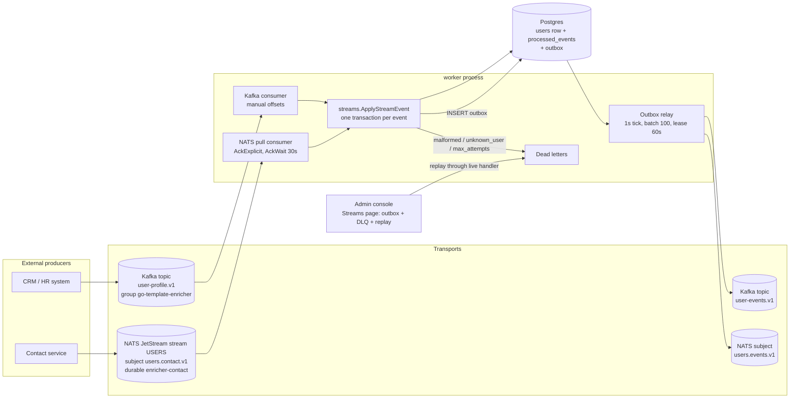
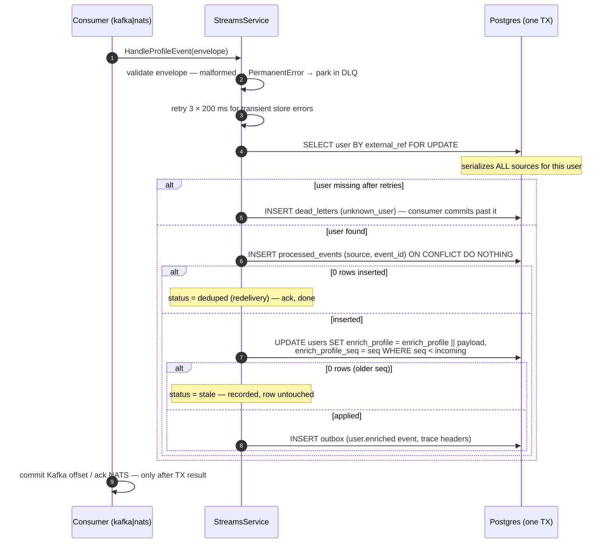
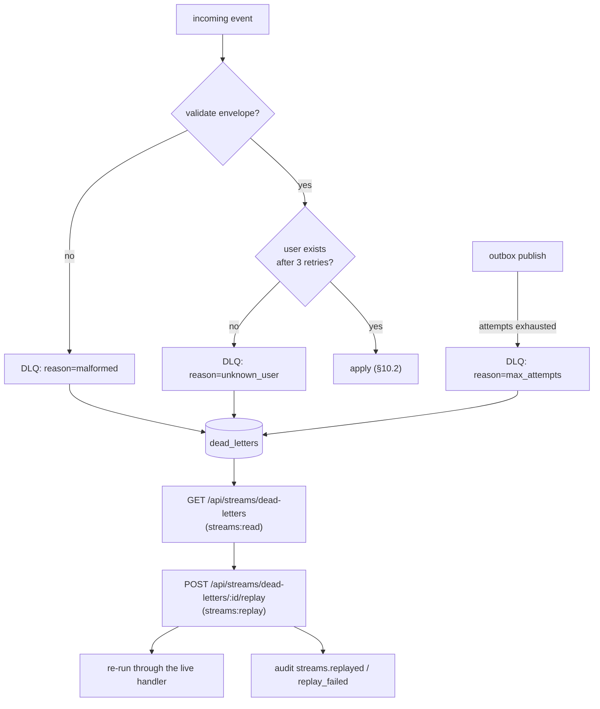

# 10 — Flows: Event Streams

**In one sentence:** two external systems (a Kafka topic and a NATS
subject) stream user facts that are merged into one Postgres row with
**exactly-once** semantics — inbox dedupe + per-source sequence guards +
field ownership — and every applied merge publishes a confirmation event
through a **transactional outbox**, with a dead-letter queue and an admin
replay console for the failures.

This is the most instructive flow in the template: it demonstrates, on a
readable scale, the patterns that keep real event-driven systems correct.

## 10.1 The topology



Message envelope (both transports): `{"event_id", "external_ref", "seq",
"occurred_at", "data": {…}}` — `external_ref` joins to
`users.external_ref`; `seq` is the producer's per-source monotonic
counter.

## 10.2 Exactly-once, in one transaction



The three guards and what each kills:

| Problem | Guard | Outcome |
|---|---|---|
| Broker redelivery (at-least-once) | `processed_events` inbox, PK `(source, event_id)` | `deduped` — no double apply |
| Out-of-order delivery within a source | per-source seq on the user row (`WHERE enrich_profile_seq < $seq`) | `stale` — old event ignored forever |
| Cross-source interference | **field ownership**: Kafka owns `enrich_profile` (company, job_title, enriched_by); NATS owns `enrich_contact` (phone, preferred_channel, enriched_by) — JSONB merge is per-source column | sources can never overwrite each other |

Kafka commits offsets only after the transaction wins
(`DisableAutoCommit` + `BlockRebalanceOnPoll`); NATS acks with
`AckExplicit`, nacks transient errors with delay (`NakWithDelay`), and
acks parked (terminal) messages so poison never blocks the partition.
Kafka-side transient failures stop the batch uncommitted — backpressure —
with backoff 500 ms → 10 s, under a supervisor restarting consumers with
exponential backoff 2 s → 30 s.

## 10.3 The transactional outbox

Why: you cannot atomically "update Postgres and publish to Kafka" —
either the publish is lost (update committed, no event) or phantom (event
published, update rolled back). The outbox makes the DB the truth:

1. The apply transaction inserts the outbound event into `outbox` —
   commit is atomic with the merge.
2. The relay loop (worker, every 1 s) claims a batch with
   `FOR UPDATE SKIP LOCKED` + a 60 s lease (multi-worker safe), publishes
   each event to **both** brokers (Kafka keyed by aggregate; NATS with
   `Nats-Msg-Id` = outbox id for server-side dedupe), guarded by breakers
   `kafka.produce` / `nats.publish`.
3. Success → `processed_at`; failure → attempts+1, and at
   `APP_OUTBOX_MAX_ATTEMPTS` (10) the event parks in the DLQ as
   `max_attempts`.
4. Processed rows are deleted after 7 days.

Downstream consumers see `user.enriched` with payload
`{user_id, external_ref, source, seq}` and propagated trace headers.

## 10.4 Dead letters and the admin replay console



Replay goes through the *live* handler (fresh dedupe/seq checks), so a
fixed producer or a late-created user makes the same payload succeed.
Already-replayed letters answer `409 already replayed`. The console lives
at Admin → Streams alongside the outbox view (`GET /api/streams/outbox`
with `pending` counts).

## 10.5 Local playground (10 minutes, fully scripted)

```bash
make demo-up          # compose + Redpanda + NATS overlay
make demo-enrichment  # publish both sources for demo-u-0001, poll until merged
make demo-dlq         # poison (malformed) + ghost user → both letters, then replay
make demo-outbox      # consume user-events.v1 and print relayed output
make demo-breaker     # in-process circuit-breaker state transitions
make demo-ratelimit   # 200 concurrent hits → 429s + Retry-After
make demo-idempotency # duplicate ticket POST with one key → one ticket
```

`cmd/devtools` subcommands (`kafka-profile`, `nats-contact`, `demo`,
`demo-dlq`, `dlq-list`, `dlq-replay`, `consume-user-events`, `hammer`,
`flaky-server`) drive each scenario; the UI equivalents are Admin →
Streams and the per-user "Publish demo enrichment" action.

## 10.6 Metrics to watch in production

| Metric | Meaning |
|---|---|
| `app_enrichment_events_total{source,result}` | applied/deduped/stale/parked per source |
| `app_outbox_pending` / `app_outbox_relay_total{result}` | relay lag and failures |
| `app_dead_letters_pending` / `app_dead_letters_replayed_total` | backlog and recovery |
| `app_cb_state{name}` | breaker states for `enrichment.http`, `kafka.produce`, `nats.publish`, `webhooks.http` |

Alert-worthy conditions: rising `app_outbox_pending` (relay behind),
sustained `app_dead_letters_pending` growth (producer or data contract
broken), any breaker sitting at `open` (2).

Next: [11 — Security](11-security.md).
