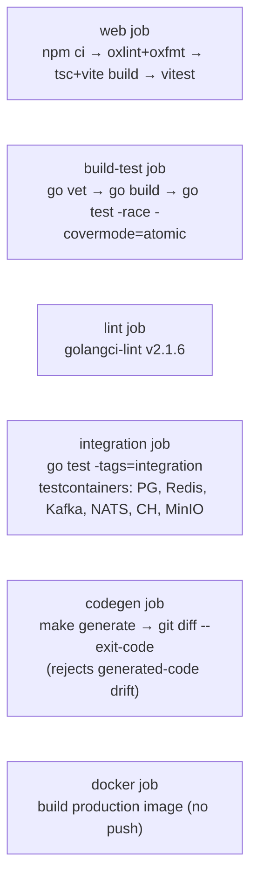
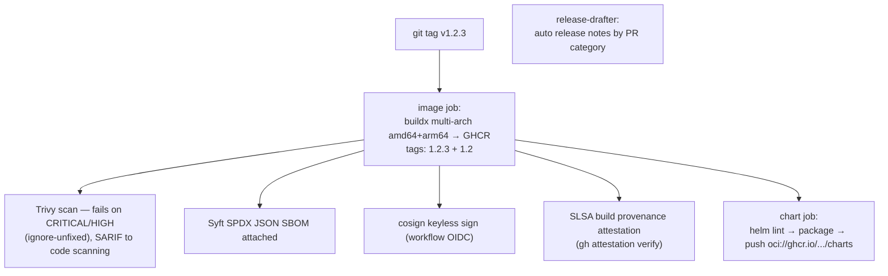

# 13 — Deployment & Operations

**In one sentence:** one distroless image carries both binaries; compose
runs the whole world locally with opt-in profiles; a Helm chart deploys it
to Kubernetes with HPA/PDB/probes/secret-mounts; and a tag push produces a
multi-arch, scanned, SBOM'd, cosign-signed image plus a Helm chart on
GHCR.

## 13.1 The image

Three-stage `Dockerfile`:

1. `node:22-alpine` — builds the SPA (`npm ci && npm run build`).
2. `golang:1.26-alpine` — copies the SPA dist in (go:embed needs it
   pre-build), `CGO_ENABLED=0 go build -trimpath -ldflags "-s -w
   -X main.version=…"` → `/out/api` + `/out/worker`.
3. `gcr.io/distroless/static-debian12:nonroot` — binaries +
   `migrations/`, `USER nonroot`, `EXPOSE 8080`, `HEALTHCHECK
   /app/api -healthcheck` (self-probe of `/health/live` — distroless has
   no shell, so healthcheck is a binary flag).

No shell, no package manager, no curl in the runtime layer.

## 13.2 Local orchestration (docker compose)

Base stack (`make docker-up`): `api`, `worker`, `postgres:16` (host port
55432), `redis:7`, `clickhouse:24.8` — with healthcheck-gated
`depends_on`, named volumes, JSON logs, demo seed on.

Opt-in extensions:

| Profile / overlay | Brings | Access |
|---|---|---|
| `mail` | Mailpit | UI `:8025`, SMTP `:1025` |
| `files` | MinIO | S3 `:19000`, console `:19001` |
| `observability` | Jaeger, Prometheus, Grafana | UI `:16686` / `:9090` / `:3000` |
| brokers overlay (`make demo-up`) | Redpanda (`:19092` external listener) + NATS (`:4222`, monitoring `:8222`); wires `APP_KAFKA_BROKERS`/`APP_NATS_URL` into api+worker; worker metrics on `:19090` | host tools talk to `localhost:19092` |

Compose details worth copying: topics are **not** auto-created (clients
create what they need — `ensureTopology` in code, `CreateTopic` in
devtools); the worker disables the inherited image healthcheck (it probes
the api binary); `docker-compose.smoke.yml` re-maps the api port when 8080
is busy (the regression script's default target is `:18080`).

## 13.3 Kubernetes (Helm)

`deploy/helm/go-template` — the chart deliberately ships **only the app**;
Postgres/Redis/ClickHouse come from your platform.

| Concern | Default |
|---|---|
| api replicas | 2 → HPA (CPU 70%) up to 10; rollout `maxUnavailable: 0, maxSurge: 1` |
| worker | 1 replica (add more — outbox lease and asynq are multi-worker safe) |
| probes | startup `/health/startup` (2 s × 30), liveness `/health/live`, readiness `/health/ready` |
| PDB | `minAvailable: 1` (api) |
| resources | api 100m/128Mi → 1 CPU/512Mi; worker 50m/64Mi → 500m/256Mi |
| securityContext | `runAsNonRoot` (65532), `readOnlyRootFilesystem`, drop ALL capabilities |
| secrets | `values.secrets.data` rendered as a Secret mounted at `/etc/go-template-secrets` with `<VAR>_FILE` wiring, or `existingSecret` |
| worker metrics | `APP_METRICS_ADDR=:9091` + scrape annotations |
| ingress | optional (nginx class, pathType Prefix) |
| progressive delivery | `rollout.enabled=true` swaps the api Deployment for an Argo Rollouts canary (20→50→100%) gated by the SLO AnalysisTemplate with auto-abort (ADR 0024); HPA target follows the workload kind |

`make helm-lint` / `make helm-template` validate locally (both modes); the
release pipeline publishes the packaged chart to
`oci://ghcr.io/<owner>/charts`, which the Argo CD Application in
`deploy/gitops/` pulls (docs/gitops.md). A Nomad alternative with native
canary + auto-revert lives in `deploy/nomad/` — `docs/orchestrators.md`
compares the orchestrator paths, including why Swarm is documented rather
than shipped.

## 13.4 CI/CD pipelines

### CI (`.github/workflows/ci.yml`, on push to main + PRs)

### Release (tag `v*` → `release.yml`)

All Actions are SHA-pinned; Go/Node versions come from `go.mod` /
`node-version: 22`.

## 13.5 Configuration reference (complete)

Everything is env-driven (12-factor); `K_FILE` reads a mounted file
instead of `K`; setting both is an error.

| Group | Variables (default) |
|---|---|
| HTTP | `APP_HTTP_ADDR` `:8080`, `APP_BASE_URL` `http://localhost:8080` |
| Logging / tracing | `APP_LOG_LEVEL` info, `APP_LOG_FORMAT` text\|json, `APP_OTLP_ENDPOINT` (empty = no-op), `APP_PPROF` 0/1 |
| Lifecycle | `APP_SHUTDOWN_TIMEOUT` 10s, `APP_EXTERNAL_TIMEOUT` 3s, `APP_MAX_CONCURRENCY` 8 |
| Database | `APP_DATABASE_URL` (empty = in-memory), pool: `APP_PG_MAX_CONNS` 20, `APP_PG_MIN_CONNS` 2, `APP_PG_CONN_MAX_LIFETIME` 30m, `APP_PG_CONN_MAX_IDLE_TIME` 5m, `APP_PG_HEALTH_CHECK_PERIOD` 1m, `APP_PG_STATEMENT_TIMEOUT` 30s, `APP_PG_IDLE_TX_TIMEOUT` 60s (server-side enforced; migrations exempt) |
| Queue / worker | `APP_REDIS_ADDR`, `APP_REPORT_CRON` `0 3 * * *`, `APP_METRICS_ADDR` |
| Sessions / cookies | `APP_SESSION_TTL` 168h, `APP_COOKIE_SECURE` 1 |
| JWT | `APP_JWT_SECRET` (≥ 32 B; unset = 501), `APP_JWT_ACCESS_TTL` 15m, `APP_JWT_REFRESH_TTL` 720h |
| Rate limits | `APP_AUTH_RATE_RPS/BURST` 5/10, `APP_API_RATE_RPS/BURST` 50/100, `APP_USER_RATE_RPS/BURST` 100/200, `APP_IDEMPOTENCY_TTL` 24h |
| OAuth | `GOOGLE_CLIENT_ID/SECRET`, `GITHUB_CLIENT_ID/SECRET`, `OAUTH_STATE_TTL` 10m, test-only endpoint overrides |
| Email | `APP_SMTP_HOST` (empty = log mailer), `APP_SMTP_PORT` 1025, `APP_SMTP_USERNAME/PASSWORD`, `APP_SMTP_FROM` |
| ClickHouse | `APP_CLICKHOUSE_ADDR` (empty = disabled), `APP_CLICKHOUSE_DB/USER/PASSWORD` |
| Streams | `APP_KAFKA_BROKERS`, `APP_KAFKA_TOPIC_PROFILE` user-profile.v1, `APP_KAFKA_TOPIC_EVENTS` user-events.v1, `APP_KAFKA_GROUP` go-template-enricher, `APP_NATS_URL`, `APP_NATS_STREAM` USERS, `APP_NATS_SUBJECT_CONTACT/EVENTS`, `APP_NATS_DURABLE` enricher-contact |
| Outbox | `APP_OUTBOX_INTERVAL` 1s, `APP_OUTBOX_BATCH` 100, `APP_OUTBOX_MAX_ATTEMPTS` 10 |
| Breakers | `APP_CB_FAILURE_THRESHOLD` 5, `APP_CB_OPEN_TIMEOUT` 30s |
| Files | `APP_S3_ENDPOINT`, `APP_S3_REGION` us-east-1, `APP_S3_BUCKET`, `APP_S3_ACCESS_KEY_ID`, `APP_S3_SECRET_ACCESS_KEY`, `APP_S3_USE_PATH_STYLE` 1, `APP_FILES_MAX_MB` 10 |
| Demo | `APP_DEMO_EMAIL`, `APP_DEMO_PASSWORD`, `APP_DEMO_SEED` 1 |

## 13.6 Scaling story

| Axis | Mechanism |
|---|---|
| api throughput | stateless — scale replicas; sessions live in Postgres, cache/limits in Redis, SSE cross-replica via Redis pub/sub |
| job throughput | more worker replicas; asynq distributes tasks; outbox relay is lease-safe (`SKIP LOCKED`) |
| stream throughput | Kafka consumer group scales by partition; NATS durable consumer scales horizontally (each message processed once — inbox dedupe makes rebalances safe) |
| database | pool tuning env; keyset pagination keeps lists O(1) at depth; `cmd/seed -users 100000` exists to prove it |
| analytics | ClickHouse absorbs event volume; the API writes are buffered (500/2 s) |

## 13.7 Operational runbook (short)

- **Deploy**: tag → pipeline → `helm upgrade` (rollout is surge-1/
  unavailable-0; probes gate traffic).
- **Migrations**: run automatically at api boot, idempotent, forward-only
  in practice (`.down` files exist); deploy order: new image rolls, first
  replica migrates, readiness gates the rest.
- **Maintenance mode**: Admin → Settings → `maintenance.enabled` (or
  `PUT /api/settings/maintenance.enabled`) — API sheds 503 within 5 s
  (memo TTL), health/metrics/SPA stay up.
- **Rotate JWT secret**: set new secret, rolling restart; access tokens
  die within 15 min, refresh tokens are independent of the secret (they're
  DB rows) — sessions unaffected.
- **Disaster**: Postgres is the only stateful source of truth; restore it
  and everything else (Redis, ClickHouse, S3 contents minus blobs)
  rebuilds or degrades per §12.3.

Next: [14 — Testing & Quality](14-testing-and-quality.md).
