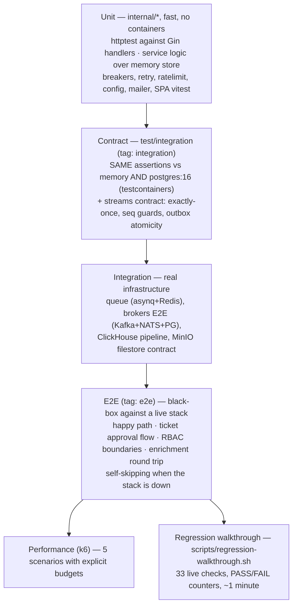
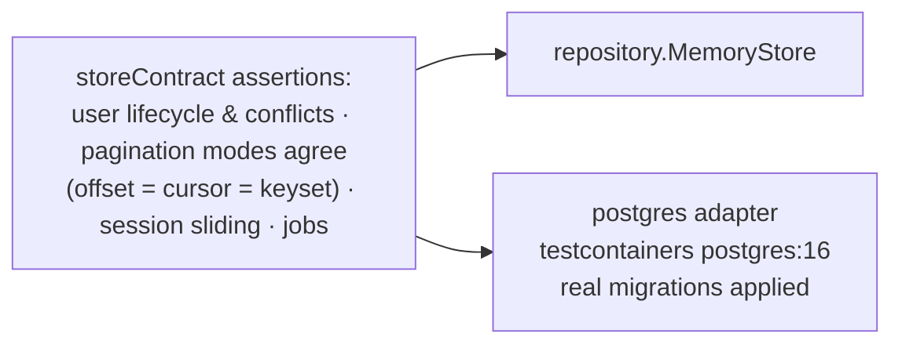

# 14 — Testing & Quality

**In one sentence:** a classic test pyramid backed by *contract testing*
— the same behavioral assertions run against the in-memory store and real
Postgres — plus broker-level integration suites, black-box e2e against a
live stack, k6 performance budgets, and a scripted 33-check regression
walkthrough a human can run in a minute.

## 14.1 The pyramid

## 14.2 Unit tests — the conventions

- Handlers are tested with `httptest` against the real Gin router built
  over the memory store and a **real Casbin enforcer** (`testutil_test.go`)
  — no handler mocks, no sqlmock anywhere; persistence is the contract
  suite's job.
- Service logic (auth, MFA, tokens, invitations, export, streams, RBAC)
  tests the domain invariants directly; `bench_test.go` guards hot paths.
- Platform pieces (breakers, retry, rate limiters, config parsing, SMTP
  mailer against a fake server) test the toolkit in isolation.
- Frontend: Vitest + Testing Library (jsdom) for pure logic today
  (`buildListQuery`, URL search schemas); component tests are the natural
  next step.

Run: `make test` (race detector always on), `make web-test`, `make coverage`
(atomic profile over `./internal/...` with a function-coverage tail).

## 14.3 Contract tests — the template's signature move

`test/integration/store_contract_test.go` defines one behavioral suite and
runs it against **two adapters**:

Why it matters: the in-memory store is not a toy that diverges — it is
*proven equivalent* on every CI run. The same pattern extends to streams
(`streams_contract_test.go`: applied/deduped/stale outcomes, owned-field
merges, atomic outbox) and the idempotency repo. Suites that need
containers **fail** if the image can't start (they're opt-in via the
`integration` build tag), except ClickHouse/MinIO suites which skip
gracefully in pull-restricted environments.

## 14.4 Integration & e2e

- **Queue**: a report job travels the real asynq path (Redis container),
  proving task-ID dedupe (`ErrTaskIDConflict`) and mux routing.
- **Streams E2E**: real Postgres + `confluent-local` Kafka + NATS with
  JetStream: produce → consume → apply → relay → consume relayed output;
  poison message parked in the DLQ and replayed.
- **ClickHouse**: buffer flush → aggregate round trip; migration
  idempotence.
- **Filestore**: put → open → byte equality → presign → delete → 404 on
  MinIO.
- **E2E (black box)**: plain net/http against a running stack
  (`GO_TEMPLATE_BASE_URL`), self-skipping with a clear reason when the
  stack or brokers are absent — including a *seeded-stack guard* that
  skips RBAC tests when the first-registered account isn't superadmin
  (i.e. someone is running against a seeded demo DB). Covers: register →
  login → me → users CRUD → report job lifecycle, the full ticket
  approval flow, RBAC 403/200 boundaries with a custom role, and the
  Kafka+NATS enrichment round trip.

## 14.5 Performance budgets (k6)

| Scenario | Load | Threshold | Proves |
|---|---|---|---|
| smoke | 10 VU / 30 s | p95 < 500 ms | base health |
| login | 50 VU / 30 s | p95 < 300 ms | Argon2id cost + rate limits behave |
| users list (3 modes) | 50 VU / 30 s | offset 500 / cursor 300 / keyset 250 ms | keyset superiority at depth |
| analytics summary | 20 VU / 30 s | p95 < 500 ms | warehouse read path |
| enrichment enqueue | 5 VU / 30 s | p95 < 2 s | queue admission under load |

Run via `make perf-*` targets (`BASE_URL` overridable); `seed` + `cmd/seed`
(100k users via pgx COPY) generate the deep-pagination data.

## 14.6 The regression walkthrough — the human gate

`scripts/regression-walkthrough.sh` (also documented step-by-step in
[docs/testing/regression-checklist.md](../testing/regression-checklist.md)) drives a live
stack through 33 checks in 10 phases: login, MFA enroll → challenge →
disable, JWT grants with rotation + reuse-detection, org invitations
(double-accept → 409), files (upload → download → attach → presign 501 →
delete), GDPR export (202 → poll → ZIP contains profile.json + tickets.json),
search + ETag/304, maintenance mode (503 + Retry-After, `/health/ready`
exempt), per-identity rate limiting (260 parallel → 429), and
`/metrics` + `/version` presence. Exit code is the verdict.

`make demo-*` targets complement it with the broker/breaker/idempotency
demos (see [10 §10.5](10-flows-event-streams.md)).

## 14.7 Quality gates & workflow

| Gate | Where |
|---|---|
| `go vet` + build + race tests | CI `build-test` |
| golangci-lint v2 (`staticcheck`, `errcheck`, `gosec`, `revive`, `unparam`, …) | CI `lint`; config `.golangci.yml` with justified, commented exclusions |
| oxlint + oxfmt + `tsc --noEmit` + vitest | CI `web` |
| Contract + integration containers | CI `integration` |
| Production image builds | CI `docker` (no push) |
| OpenSpec change required per feature | repo rule (ADR [0019](decisions/0019-openspec-workflow.md)) — `openspec/changes/<name>/{proposal,specs,tasks}` |
| Traceability matrices | `docs/testing/requirements-matrix.md`, `docs/testing/traceability-matrix.md`, `docs/testing/test-matrix.md`, `docs/testing/performance-matrix.md` updated before "done" |

The working rule of thumb, stated in the README and enforced by review:
**no feature is complete until its tests, OpenAPI, migrations/queries and
matrices exist together.**

Next: [15 — Template Guide](15-template-guide.md).
