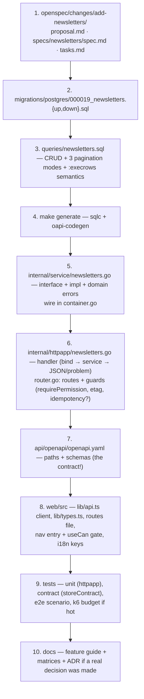

# 15 — Template Guide: making this *your* application

**In one sentence:** fork it, rename four identity strings, delete the
demo domain you don't need, then follow the "add a feature" recipe —
OpenSpec → migration → sqlc → service → handler → OpenAPI → SPA → tests →
matrices — which is exactly how every existing feature here was built.

## 15.1 Step 1 — Rebrand (a 30-minute checklist)

| What | Where |
|---|---|
| Go module path | `go.mod` + all imports (`github.com/your-org/go-template`) — `gofmt -w -r` or IDE rename |
| Deploy names | `deploy/helm/go-template/` chart name, `image.repository`, GHCR image name in `.github/workflows/release.yml` |
| Product strings | email layout `AppName` (`internal/platform/mailer/mailer.go`), login page, `index.html` title, favicon |
| Security identifiers (choose once) | session cookie `app_session` (`internal/httpapp/router.go`), API-key prefix `gtpl_` (`internal/service/apikeys.go`), JWT issuer `go-template` + MFA issuer (`internal/service/tokens.go`, `mfa.go`), webhook signature headers `X-Template-*` (`internal/service/webhooks.go`), metric prefix `app_` (`internal/observ`) |
| Demo data | `internal/bootstrap/demodata.go` (accounts, orgs, 120 tickets) and the SPA mirror `web/src/lib/demo-accounts.ts` — replace or delete |
| Docker resources | service names/ports in `docker-compose*.yml`, MinIO/Mailpit credentials |

## 15.2 Step 2 — Decide what to keep (feature removal map)

Everything is additive; remove a feature by deleting its slice in each
column and running `make test` — the contract tests will tell you if you
missed a spot.

| Feature | Backend | Data | Frontend | Notes |
|---|---|---|---|---|
| Tickets & approvals | `service/tickets.go`, `httpapp/tickets.go` | migration 000012 | routes `_client.tickets*`, `_client.approvals`, `admin.ticket-types` | also unhook `ref_type=ticket` in files, analytics events |
| Streams/enrichment | `service/streams.go`, `platform/kafka`, `platform/nats`, `bootstrap/streams.go` | migration 000013 (keep `idempotency_keys`!) | `admin.streams` | leave Postgres/Redis untouched; simplest big cut |
| Files | `service/files.go`, `platform/filestore` | migration 000018 | (no UI yet) | export ZIPs need *some* store — keep memory mode |
| Webhooks | `service/webhooks.go`, `platform/queue` delivery part | migration 000011 | `admin.webhooks` | keep asynq for other jobs |
| GDPR export | `service/export.go` | uses `files` | `/profile` card | or keep — it's 200 lines |
| MFA / token grants / invitations | the matching `service/*` + handlers | migrations 000014 / 000015 / 000017 | profile card, login step, orgs dialog | independent of each other |
| ClickHouse analytics | `platform/clickhouse`, `service/analytics.go` reads | `migrations/clickhouse` | `admin.analytics` | dashboards degrade to counters automatically |

Do **not** remove: the middleware chain, the error convention, the ports
pattern, the contract tests' dual-adapter structure, `internal/reliability`
— these are the template's spine.

## 15.3 Step 3 — The "add a feature" recipe (the real workflow)

> **Note:** the codebase is being reorganized to package-by-feature (see
> the [architecture assessment](16-current-architecture-assessment.md),
> [options](17-architecture-options.md) and
> [roadmap](18-migration-roadmap.md)). Once phases 2–3 land, "add a
> feature" becomes *create `internal/<feature>/{feature.go, http.go,
> store.go}`* — the target-state playbook is at the end of
> [18](18-migration-roadmap.md). The recipe below works for the current
> layout and for the target layout; only the file locations differ.

Worked example: adding a **"Newsletter subscriptions"** resource. Every
step has a concrete file to touch; time estimate for a CRUD+list feature
is half a day including tests.

The rules that make the recipe work:

1. **Start with the OpenSpec change** — a short proposal and a capability
   spec. This is the repo's definition of "started".
2. **Migration is append-only** — next number, `up` and `down`, no
   edits to old migrations.
3. **SQL is written by hand, reviewed like code** — 190 existing queries
   show the house style (pagination modes, `:execrows` for update-by-id
   semantics so 404 vs success is distinguishable).
4. **The service speaks errors, not HTTP** — return
   `repository.ErrNotFound`, `ErrConflict`, validation errors; the
   `fail()` helper maps them once, centrally.
5. **Permissions are catalog-first** — add actions to `service.Resources`
   (`rbac.go`), grant them to roles in `EnsureSystemRoles`, guard the
   route, and the Roles UI picks the new actions up automatically.
6. **The OpenAPI file is the source of truth** — update it even though
   routing is handwritten; generated types keep handlers honest
   (`internal/api/api.gen.go`).
7. **Frontend follows the same five-piece pattern** as every existing
   page: client functions, types, a route file with `validateSearch`, a
   nav entry gated by `useCan`, i18n keys in both languages.
8. **Tests per the pyramid** — unit for the handler logic, contract
   additions to `storeContract` if you added repo surface, one e2e
   scenario for the user journey, a k6 scenario if it's a hot path.
9. **Finish the paper trail** — feature doc in `docs/`, matrices, and if
   you decided something non-obvious, an ADR in `decisions/`.

## 15.4 Common adaptations

| You need... | Recipe |
|---|---|
| **Real login via OAuth** | extend `internal/httpapp/oauth.go`: after `LinkIdentity`, when no session exists, upsert the user by email and issue a session — keep the stateconsume-first ordering |
| **Email instead of console log in dev** | `docker compose --profile mail up -d`; Mailpit UI at `:8025` shows every message |
| **A second queue topic** (emails, webhooks separation) | add a task type in `internal/jobs/jobs.go`, a mux handler in `platform/queue`, an enqueue site; keep `TaskID` = job id |
| **Scheduled jobs** | more `asynq.NewScheduler` entries in `cmd/worker` (see `APP_REPORT_CRON`) — and wire `ExportService.Prune` while you're there |
| **Virus scanning on upload** | wrap `filestore.Store` with a decorator adapter that scans in `Put` — zero service changes |
| **Enforce API-key scopes at handler level** | consult `auth_scopes` in `requirePermission` (the context key is already set) — ~20 lines |
| **Read replicas / different DB** | only `internal/platform/postgres` knows the DSN shape |
| **Strip to a pure API** | delete `web/`, the SPA middleware, and the embed step — the API is fully standalone |
| **Single binary (no worker)** | run with no Redis: the in-process ticker processes jobs; or run `worker` logic in-process by importing its loops — both modes exist and are tested |

## 15.5 Keep these guardrails (they're why the template holds up)

1. **`internal/service` never imports an adapter package.** If you feel
   the urge, you probably need a new port instead.
2. **Every dependency stays optional.** New integration must degrade like
   the others (warn at boot, feature off, app runs).
3. **Errors are domain errors until the HTTP edge.** No `gin.Context`
   beyond `internal/httpapp`.
4. **New stateful endpoints get: idempotency or single-use semantics,
   audit, and a state machine if they have states.**
5. **The contract tests stay honest** — when Postgres and memory diverge,
   fix the adapter, don't weaken the assertion.
6. **One ADR per real decision**, even one paragraph long — future you
   is the reader.

## 15.6 Where to go next

- Run it: [docs/quickstart.md](../quickstart.md) → `make docker-up`.
- Verify the whole thing live:
  `BASE=http://localhost:8080 bash scripts/regression-walkthrough.sh` →
  expect `PASS=33 FAIL=0`.
- Read one feature end-to-end (recommended: tickets —
  [09 §9.1](09-flows-business-domains.md)) and then trace it through the
  four layers in the code; after that, you know the house style.

That's the whole template. Build something with it.
