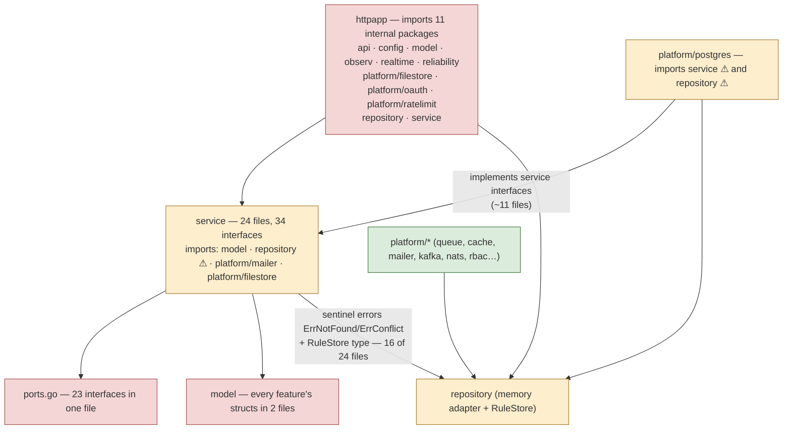

# 16 — Current Architecture Assessment

> **Update (2026-10-01): this assessment described the pre-refactor state,
> and every finding below has since been resolved.** The codebase now uses
> package-by-feature ([ADR 0021](decisions/0021-package-by-feature.md)):
> sentinel errors live in `internal/kernel` (W1), store interfaces are
> consumer-side and the adapter→domain inversion is gone (W2), the
> `ports.go`/`container.go`/`router.go` hubs were dissolved into per-feature
> packages with one-line registrations (W3), and every hand-written
> production file is ≤ 400 lines, enforced by `make check-size` in CI (W4).
> The chapter is kept as the "before" record; see
> [04 §4.1](04-components-and-code-map.md) for the "after".

**In one sentence:** the codebase is a well-disciplined layered (hexagonal)
monolith whose *technical* hygiene is good — infra never leaks into
business logic, both store adapters are contract-tested — but its
*organizational* shape fights three goals: feature locality ("which files
do I touch?"), laconic files (≤ 400 lines), and minimal abstraction.

This chapter measures the structure as it is. The options and the
recommendation follow in [17](17-architecture-options.md) and
[18](18-migration-roadmap.md).

## 16.1 Folder breakdown, annotated and measured

Non-test LOC, counted directly from the tree:

```
internal/                        24 files service-side, ~44k LOC total (excl. tests)
├── service/      24 files · 10,658 LOC   BUSINESS LOGIC — one file per feature + 3 hubs
│   ├── ports.go (321)                     ← HUB: 23 interfaces every feature plugs into
│   ├── container.go                       ← HUB: single wiring point for both binaries
│   ├── errors.go                          ← HUB: shared domain errors (validation, transition…)
│   └── rbac.go (687) tickets.go (611) streams.go (420) …  ← the 20 feature files
├── httpapp/      28 files ·  6,832 LOC   HTTP layer — flat: middleware + 20 per-feature handlers
│   ├── router.go (409)                    ← HUB: whole route table + auth plumbing
│   ├── middleware.go security.go idempotency.go maintenance.go etag.go …
│   └── api.go (394) rbac.go (391) tickets.go (257) …
├── repository/    3 files ·  6,140 LOC   In-memory adapter — one god-struct for ALL features
├── platform/     51 files · 20,792 LOC   Adapters
│   ├── postgres/  36 files · 16,776      ├── 11 files · 5,296 hand-written adapter
│   │   └── db/    25 files · 11,480      └── GENERATED sqlc (exempt from size budget)
│   └── queue 424 · filestore 440 · rbac 376 · clickhouse 343 · kafka 249 · nats 236
│       oauth 190 · cache 224 · ratelimit 139 · mailer 119
├── bootstrap/     4 files ·  3,030 LOC   Wiring + demo data (grows with every feature)
├── api/           1 file  ·  2,042 LOC   GENERATED oapi-codegen types (exempt)
├── model/         2 files ·  1,170 LOC   ALL domain structs, every feature mixed together
├── observ/        2 files ·    548 LOC   Metrics + tracing
├── reliability/   2 files ·    644 LOC   Breaker, retry, bounded concurrency
├── config/        1 file  ·    486 LOC   Env parsing
├── realtime/      1 file  ·    186 LOC   SSE hub, Redis bridge
└── jobs/          1 file  ·     60 LOC   Job contract
```

**Reading of the numbers:** hand-written application code is ~26k LOC
(service + httpapp + repository + bootstrap + model + small pkgs). The
shape is *package by layer*: a feature is spread across **five
directories** (`service/<f>.go`, `httpapp/<f>.go`, `model/<T>.go` inside
two shared files, one slot in `ports.go`, one slot in `container.go`,
several queries in `repository/memory.go` and `platform/postgres/*`).
Nothing is wrong with any single file — the cost is the *scatter*.

## 16.2 The dependency graph as it actually is

The declared rule (`httpapp → service ← adapters`) holds for third-party
libraries — zero gin/pgx/kafka/nats imports inside `internal/service` —
but the *internal* import graph has three deviations:



The three deviations, by impact:

| # | Finding | Where measured | Why it matters |
|---|---|---|---|
| W1 | **Sentinel errors live in the adapter.** `repository.ErrNotFound` / `ErrConflict` are the domain's "not found / conflict" vocabulary, so 16 of 24 service files import the in-memory adapter package. | `internal/service/*.go` → `internal/repository` | The dependency rule ("service never imports adapters") is violated *on every line* that says `ErrNotFound`. It also means deleting the memory adapter would break the domain. |
| W2 | **Adapter imports the domain back.** `platform/postgres` imports `service` in ~11 files because the store interfaces are defined *in the producer* package (`service/ports.go`) — the Java-style "interface next to implementation" placement, contrary to Go convention ("accept interfaces, return structs" — interfaces belong to the consumer). | `internal/platform/postgres/*` → `internal/service` | Interface and implementation define each other in a loop; moving or renaming a service type ripples into the adapter. |
| W3 | **Hub files force non-local edits.** Adding any feature touches `ports.go`, `container.go`, `model/model.go` (or `streams.go`), `router.go`, `bootstrap/*` — five shared files every feature fights over, plus queries spread across `repository/memory.go` (6.1k, one god-struct with a map per entity) and `platform/postgres`. | `ports.go`, `container.go`, `router.go`, `bootstrap/`, `repository/memory.go` | This is the direct opposite of "I know which files to take for a new feature". It is also where merge conflicts and review friction concentrate. |

## 16.3 File-size audit against the ≤ 400-line budget

Non-generated, hand-written files only (generated `api/api.gen.go` and
`platform/postgres/db/` are exempt):

| File | LOC | Verdict |
|---|---|---|
| `internal/service/rbac.go` | 687 | ✗ over — mixes the Casbin model text, system roles seed, permission catalog, middleware, org-domain logic, cache |
| `internal/repository/memory.go` (+`memory_streams.go`) | ~5,000 / 6,140 pkg | ✗ far over as one unit — one `MemoryStore` struct with a map per entity for all 20 features |
| `internal/service/tickets.go` | 611 | ✗ over — state machine + approvals + types + notifications + analytics in one file |
| `internal/service/streams.go` | 420 | ✗ (barely) over — consumers + apply + outbox + DLQ |
| `internal/httpapp/router.go` | 409 | ✗ (barely) over — entire route table + auth dispatch + cookie helpers |
| `internal/httpapp/api.go` | 394 | ⚠ at the line — auth endpoints + me + users + sessions in one handler file |
| `internal/service/jobs.go` 348, `mfa.go` 340, `ports.go` 321, `webhooks.go` 318 | 318–348 | ⚠ inside budget but at half its size already hub-coupled |

Also borderline by *count*, not size: `internal/httpapp` holds 28 flat
files where cross-cutting middleware and per-feature handlers sit
side by side with no grouping signal.

## 16.4 What is genuinely good (keep — the target must not lose these)

1. **Third-party discipline** — business logic imports no gin, no pgx,
   no kafka, no nats; all IO is behind interfaces. Verified, not assumed.
2. **Dual-adapter contract tests** — `test/integration/store_contract_test.go`
   runs identical assertions against memory and Postgres. This is the
   safety net that makes any re-organization survivable.
3. **Central error mapping** — domain errors → HTTP once, in `httpapp/errors.go`.
4. **One wiring point** — `container.go` makes the object graph explicit
   (its problem is only that it is a *hub*).
5. **Graceful degradation** — every dependency optional (ADR 0004).
6. **Feature-sized files on average** — 20 of 24 service files are under
   350 LOC; the discipline exists, it is just applied to the wrong axis
   (file size, not feature locality).

## 16.5 Current flow (summary — full versions already documented)

- **HTTP request:** middleware chain (security headers → request id →
  trace → metrics → access log → maintenance → body cap → rate limits →
  origin check → auth → org domain → per-route permission/ETag/idempotency)
  → handler binds to generated type → service call → JSON or
  problem+json. Step-by-step: [04 §4.3](04-components-and-code-map.md).
- **Worker/stream:** asynq consume · Kafka/NATS consume → apply (inbox +
  sequences + ownership) → outbox → relay → DLQ/replay.
  [10](10-flows-event-streams.md).
- **Business flows** (tickets, files, export, webhooks, notifications):
  [09](09-flows-business-domains.md). **Auth flows:** [07](07-flows-authentication-and-identity.md).

## 16.6 Verdict

Nothing here needs a *rewrite* — the weaknesses are organizational, and
they are exactly the ones the Go community's package-by-feature school
addresses (Ben Johnson's Standard Package Layout, Mat Ryer's HTTP-service
patterns, Simon Brown's "package by feature, not layer"; sources and
full comparison in [17](17-architecture-options.md)). The evolution path
is: fix the error-direction wart, then move each feature into its own
package until "add a feature" means "create these three files". The
[roadmap](18-migration-roadmap.md) does this incrementally with the
contract tests as the guardrail.
